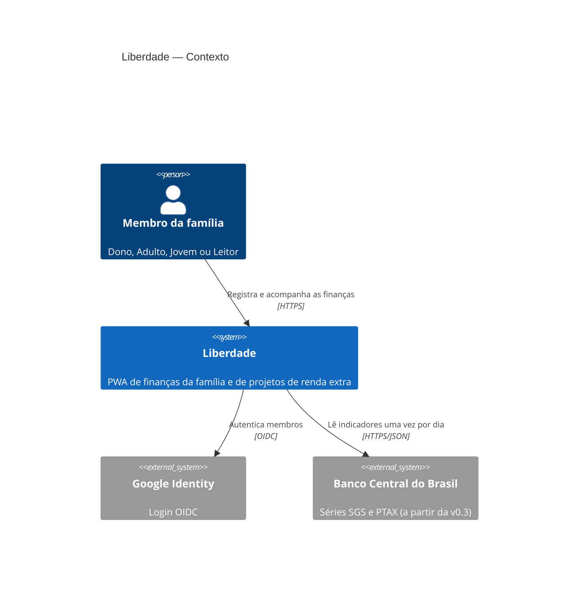
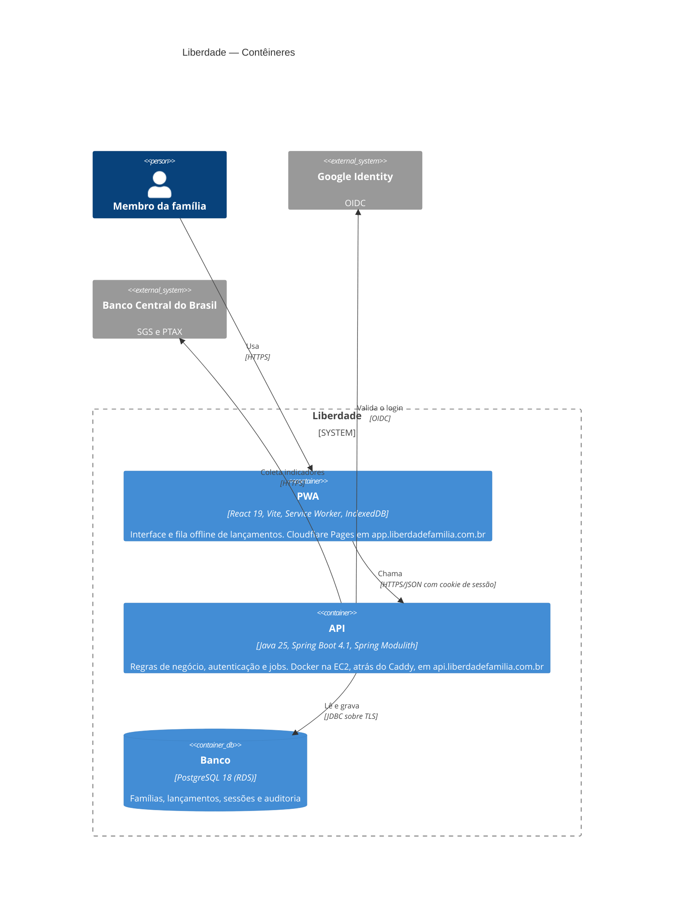
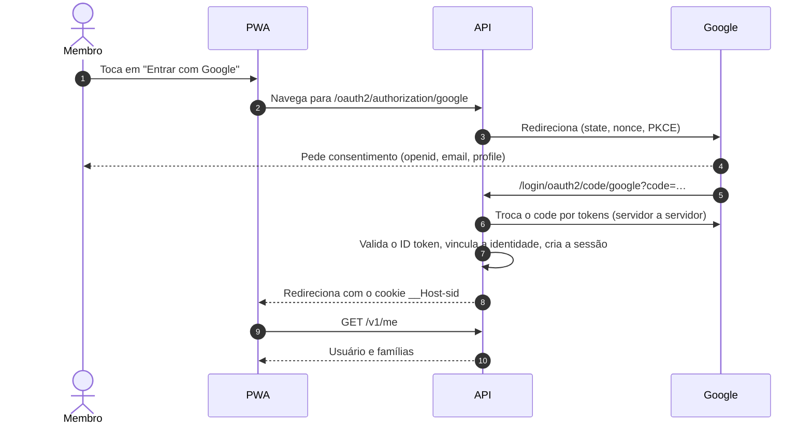
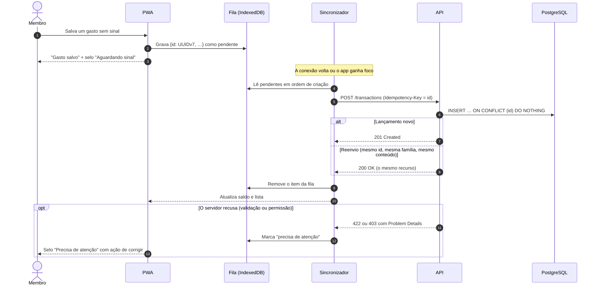
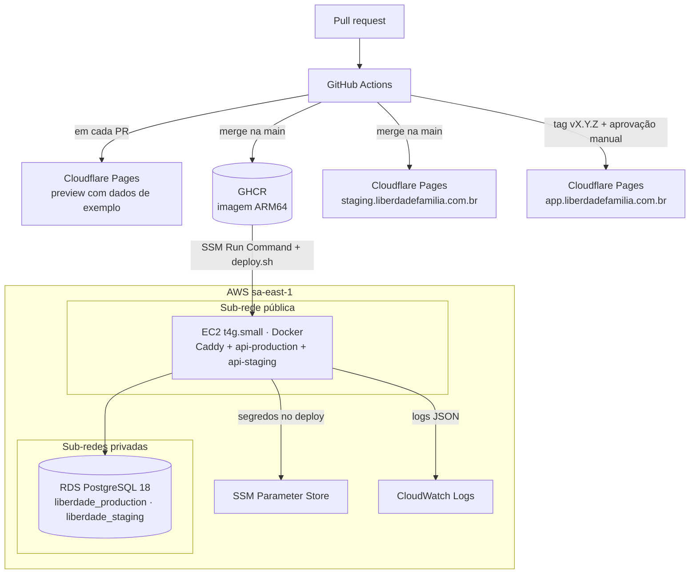

# Arquitetura

> **Status:** rascunho para revisão · **Data:** 2026-11-02 · Diagramas em Mermaid (C4 + fluxos)

## 1. Resumo

- **Front:** PWA em React 19 + Vite + TypeScript, com Service Worker e fila offline em IndexedDB.
  Hospedado no Cloudflare Pages.
- **API:** monólito modular em Java 25 + Spring Boot 4.1 + Spring Modulith, empacotado em Docker
  (ARM64) e rodando em uma EC2 `t4g.small` atrás do Caddy (TLS automático).
- **Banco:** PostgreSQL 18 no RDS (`db.t4g.micro`), criptografado, em sub-rede privada.
- **Região:** AWS `sa-east-1` (São Paulo), dados no Brasil.
- **Sem senha:** login com Google (OIDC) e passkeys (WebAuthn), sessão em cookie `HttpOnly`.

Decisões e alternativas: [ADRs](adr/README.md). Custos: [ADR-0004](adr/0004-hosting-aws-sa-east-1-lean.md).

## 2. Contexto (C4 nível 1)



## 3. Contêineres (C4 nível 2)



## 4. Componentes da API

A API é um **monólito modular**: um único deploy, com módulos isolados por pacote e verificados
pelo Spring Modulith em teste. Cada módulo expõe só o pacote raiz (serviços, eventos e tipos
públicos); o subpacote `internal` é privado.

```mermaid
flowchart LR
  subgraph núcleo[Núcleo — sempre ligado]
    identity[identity<br/>login, passkeys, sessões]
    workspace[workspace<br/>famílias, membros, papéis,<br/>convites, módulos ligados]
    ledger[ledger<br/>contas, categorias,<br/>lançamentos, saldos, painel]
    audit[audit<br/>trilha de auditoria]
    privacy[privacy<br/>consentimentos,<br/>exportar e excluir]
    billing[billing · Plano 6<br/>plano pago, pedidos,<br/>gateway e webhook]
  end
  subgraph opcionais[Módulos opcionais]
    planning[planning<br/>recorrências e previstos<br/>(v0.2: orçamentos, metas, reserva)]
    indicators[indicators · v0.3<br/>coleta do BCB]
    gamification[gamification · v0.3<br/>sequências, conquistas]
    ventures[ventures · v0.4<br/>Novo Projeto]
  end
  live[live · Plano 7.3<br/>avisos ao vivo por SSE]
  shared[(shared<br/>Money, erros, relógio,<br/>limitador de taxa)]
  workspace --> identity
  ledger --> workspace
  planning --> ledger
  gamification --> ledger
  ventures --> ledger
  live --> identity & workspace & ledger & planning
  live -. ouve eventos .-> ledger & planning & workspace
  audit -. ouve eventos .-> identity & workspace
  audit --> identity & workspace
  privacy --> ledger & audit & workspace & identity & billing
  billing --> workspace & identity
  audit -. ouve eventos .-> billing
```

Setas significam "depende de". Regras verificadas por teste:

1. O núcleo **nunca** depende de um módulo opcional. Isso garante o critério S2: desligar um
   módulo nunca quebra o núcleo.
2. Módulos opcionais conversam com o núcleo pela API pública dele ou por eventos de domínio
   (`TransactionRecorded`, `MemberJoined` etc.).
3. Eventos são publicados em memória e ouvidos de forma síncrona (`@EventListener`), na mesma
   transação de quem publica: se um ouvinte falhar, a ação inteira volta atrás, e o evento e a ação
   valem juntos. Sem Kafka ([ADR-0003](adr/0003-modular-monolith-spring-modulith.md)).
4. `shared` só tem tipos sem regra de negócio de módulo: `Money`, `Problem` (erros), `Clock` e o
   limitador de taxa genérico (`RateLimiter`, `RateLimitedException`).

### Módulos ligáveis

- A tabela `workspace_modules` guarda o que cada família ligou.
- Endpoints de um módulo desligado respondem `403` com o código `module.disabled`.
- Sequências e conquistas são **derivadas do histórico** de lançamentos, não acumuladas por evento.
  Por isso, religar um módulo recalcula tudo e não deixa buraco.

### Cobrança (módulo `billing`, Plano 6)

O módulo `billing` guarda o plano pago da família e fica no pacote
`br.com.liberdadefamilia.billing`. Ele depende só de `identity`, `workspace` e `shared`; quem o
usa chama o pacote raiz (`Plans`, `@RequiresPlan`, `BillingExport`) ou ouve os eventos
`PlanActivated`, `PlanEnded`, `RefundRequested` e `CheckoutStarted`. O preço e a oferta
(Família Fundadora, produto `FOUNDER_2026`) ficam no código, não no banco.

- **Gateway.** A interface `PaymentGateway` esconde o Asaas. `AsaasGateway`
  (`liberdade.billing.gateway=asaas`) é o real; `FakePaymentGateway` serve ao dev, ao `e2e` e aos
  testes e **não sobe** com o perfil
  `prod` (o `BillingStartupCheck` recusa a partida). O pagamento acontece na página hospedada do
  Asaas: o app nunca vê cartão, Pix nem CPF. O link do checkout só vale se o host estiver em
  `liberdade.billing.checkout-hosts`.
- **Configuração segura por padrão.** `liberdade.billing.enabled` e `presale-open` vêm `false`. A
  venda só fica ligada com a chave (`ASAAS_API_KEY`) e o token do webhook
  (`ASAAS_WEBHOOK_TOKEN`, de 32 a 255 caracteres). Faltando algo, a API sobe, a venda fica
  desligada e há um aviso no log, sem valores. Com a cobrança ligada, os termos e a política em
  vigor passam a ser os `2026-12`.
- **Webhook.** `POST /v1/billing/webhooks/asaas` é público, limitado a 120 chamadas por minuto e a
  um corpo pequeno, e só aceita o cabeçalho `asaas-access-token` igual ao token (comparação em
  tempo constante). Cada evento entra uma vez em `billing_webhook_events` (o `id` do evento é a
  chave, então reentrega não faz nada) e o efeito roda num savepoint: se uma regra falhar, o
  evento fica com `outcome = ERROR`, a API responde `200` mesmo assim e emite o alerta
  `WEBHOOK_ERROR`. Erro de banco não é capturado. Eventos tratados: `CHECKOUT_PAID`,
  `CHECKOUT_EXPIRED`, `CHECKOUT_CANCELED`, `PAYMENT_REFUNDED`, `PAYMENT_CHARGEBACK_REQUESTED` e
  `PAYMENT_CHARGEBACK_DISPUTE`; os outros são ignorados. Só o necessário vai ao banco, nunca o
  corpo do evento.
- **Dois caminhos para o mesmo pagamento.** O webhook e a volta da pessoa ao app
  (`POST .../billing/orders/{id}/refresh`) chamam `OrderPayments.applyPaid`. A linha do pedido
  decide quem age, então não há plano em dobro. Se a família já tinha plano ou deixou de existir,
  o pagamento vira reembolso `DUPLICATE`.
- **Reembolso.** Em até 7 dias (`RefundWindow`: o dia do pagamento não conta e o sétimo dia vale
  inteiro, no fuso de São Paulo), `POST .../billing/orders/{id}/refund` põe o pedido
  em `REFUND_PENDING`, encerra o plano e, depois do commit, pede o estorno ao Asaas. Se o Asaas
  falhar, o pedido espera a rotina horária (a cada hora, até 72 h). O estorno confirmado
  (`PAYMENT_REFUNDED`) leva a `REFUNDED`.
- **Rotinas** (`America/Fortaleza`): `BillingRetryJob` a cada hora (reembolsos pendentes, o
  `asaas_payment_id` que faltou e, por até 48 h, checkouts pagos cujo webhook não chegou) e
  `BillingPurgeJob` às 3h55 (eventos com mais de 180 dias, pedidos nunca pagos com mais de 180
  dias, pedidos pagos com mais de 5 anos, e o aviso de reembolso parado há mais de 72 h).
- **Plano e rotas.** `GET .../billing/plan` e `PUT .../billing/plan/theme` (tema do Fundador).
  `@RequiresPlan`, com o `PlanGuardInterceptor`, responde `403 plan.required`
  (`PlanRequiredException`) quando a família não tem o plano.
- **Alertas.** `BillingAlerts` escreve `BILLING_ALERT type=<TIPO>` no nível WARN, com `TIPO` em
  `CHARGEBACK`, `REFUND_STUCK` e `WEBHOOK_ERROR`, sem valores nem ids. Em
  `infra/live/billing_alerts.tf`, um filtro de métrica por ambiente (`/liberdade/staging` e
  `/liberdade/production`) conta o
  termo `"BILLING_ALERT"` e o alarme `liberdade-billing-alert-{ambiente}` (soma em 300 s, limite
  1, dados ausentes não contam) avisa o tópico SNS de alertas em `ALARM` e em `OK`. **Um e-mail
  por janela de alarme:** um segundo alerta enquanto o alarme já está em `ALARM` não manda e-mail
  novo, então quem lê o e-mail confere os logs de todos os tipos daquela janela. Veja o
  [runbook do sandbox](runbooks/billing-sandbox.md).
- **Retrato do mês.** É só do front: o cartão é desenhado e compartilhado no aparelho, sem chamada
  de rede e sem dado novo no servidor.

### Planejamento (módulo `planning`, Plano 7.1)

O módulo `planning` guarda as recorrências e os lançamentos previstos que elas geram, e fica no
pacote `br.com.liberdadefamilia.planning`. Ele depende só de `workspace`, `ledger` e `shared`;
`audit` e `privacy` o enxergam por `RecurringRuleArchived` e `PlanningExport`.

- Vem ligado por padrão em toda família. Desligar o módulo tira Recorrências do Mais e Previstos da
  lista de lançamentos; o resto do app segue igual.
- Um previsto é uma linha de `transactions` com `status = PLANNED`, e nenhuma soma a conta. Confirmar
  o previsto o torna um lançamento comum, e pular é excluí-lo, com desfazer.
- **Rotina diária das 4h10** (`America/Sao_Paulo`, `RecurrenceJob`): gera os previstos das regras
  ativas. Cada ocorrência vale uma só vez (índice único por regra e data), então rodar de novo ou
  religar o módulo não duplica nada.

#### Plano 7.2: orçamento, metas, reserva e projeção

O `planning` ganha orçamento por categoria, metas com aportes, reserva de emergência, projeção do
saldo e a divisão entre gastos fixos e variáveis. Mesmo com mais coisa, ele continua fora do
`ledger`: o `ledger` nunca depende do `planning`.

- **Dependências.** O `planning` declara `allowedDependencies = {"workspace", "ledger", "billing",
  "shared"}`. A dependência `planning → billing` existe só para o limite de metas do plano Grátis
  (3 metas ativas); com a cobrança desligada, não há limite. O `billing` não depende do `planning`.
- **Porta `LedgerFigures`.** É a única entrada do `planning` nos números do `ledger`: gasto
  confirmado por categoria e por mês, saldos (ativo e da reserva), contas e categorias, divisão
  fixo/variável e os fluxos que ainda vão acontecer. Cada método olha só a família pedida.
- **Eventos do `ledger`.** `TransactionChanged` e `AccountChanged` saem de dentro da transação que
  mudou o dado. O `planning` os ouve depois do commit (`GoalAchievementListener`) para marcar a meta
  atingida; o ouvinte loga só o nome da classe da falha, nunca valores nem nomes.
- **Rotas.** Todas levam `@RequiresModule(ModuleKey.PLANNING)` e `@WorkspaceScoped`. Orçamento,
  reserva, projeção e fixo/variável são negados ao Jovem (403); as metas os quatro papéis leem, e o
  Jovem nunca recebe a conta vinculada.
- **Slots do web** (`shared/modules/slots.ts`). `registerSlot('home' | 'workspace', entrada)` deixa
  um módulo opcional pôr um componente no núcleo sem o núcleo importá-lo. O `<ModuleSlot>` filtra
  pelo módulo ligado e pelo papel, e põe cada entrada num `Suspense` e num limite de erro. O Início
  usa o slot `home` (cards do orçamento, da reserva, da projeção e de fixo/variável); o
  `WorkspaceLayout` usa o slot `workspace` para os observadores invisíveis. Os cards e as telas
  carregam sob demanda, fora do carregamento inicial (`check:chunks`).
- **Barramento local** (`shared/events/localActions.ts`). `emitLocalAction` e `onLocalAction` levam
  `transaction-saved` e `contribution-saved` do núcleo para o planejamento. Quem vem da fila offline
  (`fromQueue: true`) invalida as consultas, mas não gera aviso nem celebração.
- **Avisos.** O aviso de 80% e 100% do limite e a celebração de meta atingida guardam o que já foi
  dito no `localStorage` do aparelho (com `try/catch`), sem som e sem vibração.
- **Navegação.** A barra inferior ganha Planejar entre "+ Novo gasto" e Mais enquanto o módulo está
  ligado (cinco itens; quatro quando desligado). Recorrências passou para `/planejar/recorrencias`.

### Avisos ao vivo (módulo `live`, Plano 7.3)

O módulo `live` leva ao navegador o aviso de que algo mudou na família, para as telas abertas em
outros aparelhos se atualizarem sem recarregar. Ele lê de `identity`, `workspace`, `ledger` e
`planning`, e ninguém depende dele (o Modulith confere). A decisão está no
[ADR-0016](adr/0016-live-sync-sse-in-process.md).

- **Rota.** `GET /v1/workspaces/{ws}/events` (`text/event-stream`, os quatro papéis). Manda `retry:
  5000` e um comentário de abertura, e depois um evento `changed` por mudança, com só ids:
  `{"entity":"transaction","id":"…"}`. Cada stream dura até 30 min.
- **Registro.** `LiveStreams` é a interface (`open`, `publish`, `closeMember`, `closeWorkspace`,
  `all`, `close`); `InMemoryLiveStreams` a implementa com um mapa por família. É o ponto de troca
  por `LISTEN/NOTIFY` se a API passar a ter mais de um processo.
- **Eventos novos.** Para o `live` ouvir, saem `AccountOwnerChanged`, `CategoryChanged` e
  `TagChanged` (`ledger`), `BudgetChanged` e `GoalChanged` (`planning`) e `MemberProfileChanged`
  (`workspace`); `AccountService.create` passa a publicar `AccountChanged`. O `LiveRelay` ouve todos
  depois do commit e escolhe a audiência: todos, todos menos o Jovem (orçamento, reserva e
  recorrências) ou quem enxerga a conta (`AccountVisibility`). Os avisos do planejamento só saem com o
  módulo ligado.
- **Batida a cada 25 s** (`LiveHeartbeat`). Manda um comentário e fecha o stream de quem perdeu a
  sessão (`SessionLiveness`) ou a participação (`Memberships.activeAmong`). Mudar o papel ou remover
  o membro fecha os streams dele na hora; pedir a exclusão da família fecha os da família.
- **Limites.** 5 streams por pessoa e 1.000 por processo; acima disso, `429 rate.limited` com
  `Retry-After: 60`. O fim do stream passa de novo pelos filtros, por isso o `SecurityConfig` e o
  `WorkspaceGuardInterceptor` deixam passar o despacho `ASYNC`.
- **Web** (`shared/live`). O `LiveSync`, montado no `WorkspaceLayout`, abre o stream só com a aba
  visível e com rede, junta os avisos por 250 ms e busca de novo as consultas afetadas. Reconectar
  busca tudo. Sem stream (429, 204, 401), o app busca de novo ao voltar à aba ou à rede, e tenta
  abrir uma vez por minuto.
- **Som e movimento.** `shared/sound` toca um som curto de conquista, desligado por padrão e ligado
  em Mais > Ajustes (`/mais/ajustes`, no aparelho). O sintetizador carrega sob demanda e o
  `check:chunks` confere que ele fica fora do carregamento inicial. As animações usam os tokens de
  movimento e param com movimento reduzido.

### Família, Jovem e exclusão

- **Sempre um Dono ativo.** Uma família nunca fica sem Dono ativo: pedir a exclusão da conta do
  último Dono responde `409 account.sole-owner`; rebaixá-lo ou removê-lo, `422 member.last-owner`. Conta como ativo só o Dono cuja conta não
  tem exclusão pedida. A checagem trava as linhas dos Donos (`FOR UPDATE`, em ordem de id), para
  que duas ações ao mesmo tempo não deixem a família sem ninguém.
- **Jovem só com passkey.** Quem entra como Jovem precisa de uma conta só com passkey (sem Google):
  aceitar um convite de Jovem com Google, ou mudar para Jovem um membro com Google, responde `422`.
  O convite de Jovem leva o consentimento parental de quem convidou. Quando o membro deixa de ser
  Jovem, esse consentimento é encerrado como substituído. Um Dono ativo pode revogá-lo mesmo que
  quem consentiu já tenha saído.
- **Convites.** O token vai no fragmento da URL (`/convite#<token>`), que não chega ao servidor
  nem aos logs. O banco guarda só o hash. O convite vale 7 dias e uma vez só; o link de
  recuperação vale 24 horas.
- **Exclusão com carência.** Pedir a exclusão da conta ou da família abre 30 dias de carência. Na
  carência, o `PendingDeletionFilter` deixa a conta só ver o `me`, cancelar o pedido e exportar os
  dados; o resto responde `403 account.deletion-pending`.
- **Rotinas noturnas** (`America/Fortaleza`): auditoria antiga às 3h10, convites vencidos às 3h15,
  lançamentos excluídos às 3h30, contas às 3h45 e famílias às 3h50. Cada conta e cada família é
  apagada na própria transação: uma falha não desfaz as outras.

## 5. Estrutura do front

```
web/src/
  app/          rotas, providers, layout, registro de módulos
  features/
    auth/  onboarding/  transactions/  accounts/  categories/
    dashboard/  members/  modules/  privacy/
    recurrences/  planning/ (v0.2)  indicators/ gamification/ (v0.3)  ventures/ (v0.4)
  shared/
    ui/         componentes do design system (Radix + Tailwind)
    money/      centavos em bigint, formatação com Intl
    offline/    fila IndexedDB (Dexie) e sincronizador
    api/        cliente HTTP, tipos gerados do OpenAPI, Problem Details
    i18n/       mensagens pt-BR
```

- **Dados do servidor:** TanStack Query, com cache persistido para leitura offline.
- **Módulos:** cada feature opcional se registra com `moduleKey`. O registro esconde rotas, menu e
  cards quando o módulo está desligado. Uma feature opcional só importa de `shared/` e da API do
  núcleo, nunca de outra feature opcional (regra de lint).
- **Gráficos:** ECharts (Apache-2.0), carregado sob demanda.

## 6. API v0.1 (resumo)

REST + JSON em `/v1`, contrato OpenAPI 3.1 gerado pela API; o front gera tipos TypeScript a partir
dele. Erros seguem RFC 9457 (Problem Details), com `code` estável e `detail` em pt-BR. Dinheiro
trafega como texto decimal: `{"amount": "1234.56", "currency": "BRL"}`.

| Recurso | Operações |
|---|---|
| Sessão | `GET /oauth2/authorization/google`, endpoints WebAuthn do Spring Security, `POST /logout`, `GET /v1/csrf` |
| Eu | `GET /v1/me`, `POST /v1/me/export`, `POST /v1/me/deletion`, `DELETE /v1/me/deletion`, `GET /v1/me/activity`, `GET /v1/me/consents`, `DELETE /v1/me/consents/{id}`, `POST /v1/me/getting-started/dismiss`; no Plano 5, `GET /v1/me/documents`, `POST /v1/me/documents/accept`, `GET /v1/me/passkeys` e `DELETE /v1/me/passkeys/{id}` (reautenticação de 10 min; `422 passkey.last-method` se for o último jeito de entrar) |
| Famílias | `POST /v1/workspaces`, `PATCH /v1/workspaces/{ws}` (nome; a família vem no `GET /v1/me`), `POST .../export`, `POST .../deletion`, `DELETE .../deletion` |
| Membros | `GET /v1/workspaces/{ws}/members`, `PATCH .../members/{id}` (papel e apelido), `DELETE .../members/{id}`, `POST .../members/{id}/recovery` (link de recuperação) |
| Convites | `GET /v1/workspaces/{ws}/invitations`, `POST .../invitations` (com `parentalConsent` quando o papel é Jovem), `DELETE .../invitations/{id}`, `POST /v1/invitations/preview` e `POST /v1/invitations/accept` (anônimas, com o token no corpo, nunca na URL) |
| Módulos | `GET /v1/workspaces/{ws}/modules`, `PUT .../modules/{key}` |
| Contas | `GET`, `POST`, `PATCH .../accounts/{id}`, `POST .../accounts/{id}/archive`, `POST .../accounts/{id}/unarchive`, `PUT .../accounts/{id}/owner` (titular) |
| Categorias | `GET`, `POST`, `PATCH .../categories/{id}`, `POST .../categories/{id}/archive`, `POST .../categories/{id}/unarchive` |
| Lançamentos | `GET .../transactions?month=2026-11&accountId=&categoryId=`, `GET .../transactions/{id}`, `POST` (com `Idempotency-Key`), `PATCH .../transactions/{id}` (com `version`), `DELETE .../transactions/{id}`, `POST .../transactions/{id}/restore` |
| Painel | `GET /v1/workspaces/{ws}/dashboard?month=2026-11` |
| Avisos ao vivo (Plano 7.3) | `GET /v1/workspaces/{ws}/events` (SSE; só ids; 429 acima de 5 por pessoa ou 1.000 no processo) |
| Cobrança (Plano 6) | `POST /v1/workspaces/{ws}/billing/checkout`, `POST .../billing/orders/{id}/refresh`, `POST .../billing/orders/{id}/refund`, `GET .../billing/plan`, `PUT .../billing/plan/theme`; o gateway chama `POST /v1/billing/webhooks/asaas` (público, com o cabeçalho `asaas-access-token`) |

As páginas `/privacidade` e `/termos` são públicas e ficam só no front, com a versão e a data no
topo (`privacy-2026-11` e `terms-2026-11` na v0.1). Quando falta aceitar a versão atual, o web
mostra "Antes de começar" antes de qualquer tela da família; é regra do web, não da API.

Toda rota sob `/v1/workspaces/{ws}` verifica se o usuário é membro ativo de `{ws}` e se o papel
permite a ação (matriz da US-10), negando por padrão.

## 7. Fluxos

### 7.1 Entrar com Google



Passkeys usam o suporte nativo a WebAuthn do Spring Security: registro depois do primeiro login,
ou direto pelo link de convite/recuperação.

### 7.2 Lançar sem internet



Regras do sincronizador:

- **Falha de rede, timeout ou 5xx:** o item continua pendente; nova tentativa com recuo exponencial
  e jitter (2 s, 4 s, 8 s… até 5 min) e sempre que o app ganha foco. O iOS não tem Background Sync,
  por isso o gatilho de foco é obrigatório.
- **401 (sessão expirou):** o item continua pendente; o app pede login e retoma depois.
- **Mesmo `id` com conteúdo diferente ou de outra família:** a API responde `409`
  `transaction.id-conflict` sem revelar nada do registro existente; o item fica "precisa de
  atenção". Na prática não acontece, porque o UUIDv7 é gerado no aparelho, mas a checagem impede
  que alguém leia dados de outra família adivinhando ids.
- **Desfazer antes de sincronizar:** remove da fila sem chamar a API.
- Editar e excluir exigem conexão e usam `version` (lock otimista); conflito responde `409` com o
  código `transaction.version-conflict` e a versão atual.

## 8. Implantação



| Ambiente | Front | API | Banco |
|---|---|---|---|
| Local | `localhost:5173` | `localhost:8080` | PostgreSQL 18 em Docker |
| Preview (PR) | `<hash>.<projeto>.pages.dev` | API simulada no navegador (MSW) | — |
| Staging | `staging.liberdadefamilia.com.br` | `api-staging.liberdadefamilia.com.br` | `liberdade_staging` |
| Produção | `app.liberdadefamilia.com.br` | `api.liberdadefamilia.com.br` | `liberdade_production` |

- **Nomes:** os ambientes se chamam `staging` e `production` em todo lugar (GitHub Environments,
  caminhos do SSM `/liberdade/<ambiente>/<NOME>`, serviços do Compose, grupos de log e bancos).
- **DNS no Cloudflare** (plano gratuito, [ADR-0014](adr/0014-dns-cloudflare-and-costs.md)); o
  registro continua no Registro.br. `api` e `api-staging` são registros A só DNS para o IP elástico,
  e o Caddy emite o certificado pelo desafio HTTP-01. O domínio de topo redireciona para o `app`.
- **Front:** um projeto do Pages por ambiente (`liberdade` para previews, `liberdade-staging` e
  `liberdade-production`). O build gera `dist/_headers` com a CSP e os cabeçalhos de segurança, e
  o `vite preview` serve os mesmos cabeçalhos, para o E2E rodar sob a CSP real.
- **Deploy da API:** imagem com tag `sha-<commit>`. O workflow assume o papel `liberdade-deploy` por
  OIDC e manda um comando do SSM que baixa `deploy/` no mesmo commit e roda `deploy.sh`: grava o
  arquivo de ambiente lido do SSM (tmpfs, modo 0600), troca só o serviço do ambiente, recarrega o
  Caddy e espera o healthcheck por até 180 s; se a API não ficar saudável, volta para a tag
  anterior. Staging sobe a cada merge na `main`; produção sobe com a release do release-please e
  aprovação manual. Os jobs só rodam com a variável de repositório `DEPLOY_ENABLED=true`.
- **Previews de PR usam dados de exemplo**, não o staging. O domínio `pages.dev` é outro site, e
  o cookie de sessão (`SameSite=Lax`) não iria junto nas chamadas. Para testar com login real,
  usa-se o staging.
- **Staging e produção dividem a EC2 e a instância RDS**, com bancos e usuários de banco separados
  (o usuário do staging não acessa o banco de produção). Esse é o preço do custo baixo: um pico no
  staging pode afetar a produção. Aceitável para uso familiar.
- **Infraestrutura como código** com OpenTofu (MPL-2.0) em `infra/`, para recriar tudo do zero.
- **Migrações** com Flyway, só para frente, no padrão expandir/contrair.
- **Rollback:** `workflow_dispatch` do deploy com uma tag ou SHA anterior; migrações são compatíveis
  com a versão anterior (runbook `docs/runbooks/rollback.md`, escrito no Plano 5).
- **Caminho para escalar:** trocar a EC2 por ECS Fargate + ALB e ligar Multi-AZ no RDS, sem mudar
  código.

## 9. Segurança

Referência: **OWASP ASVS 5.0, nível 2**, com checklist revisado a cada release.

| Tema | Medida |
|---|---|
| Autenticação | Sem senha: Google OIDC (escopos mínimos, PKCE, `nonce`) e passkeys. O 2FA vem do Google ou da própria passkey. |
| Sessão | Spring Session JDBC (sobrevive a reinícios). Cookie `__Host-sid`: `HttpOnly`, `Secure`, `SameSite=Lax` (o retorno do Google é uma navegação vinda de outro site e precisa levar o cookie). Novo id a cada login; expira após 30 dias sem uso. A sessão aberta antes do login (token de CSRF, ida ao Google) expira após 30 minutos sem uso. |
| Reautenticação | Exportar dados, excluir conta ou família, mudar papel, remover membro e gerar link de recuperação exigem login nos últimos 10 min. |
| CSRF | Token obtido em `GET /v1/csrf`, guardado em memória e enviado em `X-XSRF-TOKEN`; checagem de `Origin`. |
| CORS | Só a origem do front do mesmo ambiente, com credenciais. Expõe só `Retry-After` e `Content-Disposition` (o nome datado do arquivo exportado). |
| Exclusão pendente | Na carência de 30 dias, só `GET /v1/me`, `POST`/`DELETE /v1/me/deletion`, `POST /v1/me/export` e `GET /v1/csrf`; o resto responde `403 account.deletion-pending`. |
| Retorno após login | O caminho de volta só aceita uma lista fixa (`/convite`, `/mais/familia`, `/mais/privacidade`, `/mais/modulos`), nunca URL externa. |
| Sessão entre abas | Sair numa aba avisa as outras por `BroadcastChannel`, que limpam os dados locais e vão para `/entrar`. |
| Autorização | Guarda única por rota: membro ativo + papel; nega por padrão; teste da matriz da US-10 por papel. |
| Isolamento | `workspace_id` em toda tabela, FKs compostas, filtro obrigatório e testes entre famílias ([ADR-0008](adr/0008-workspace-isolation.md)). |
| Limites | Limite de taxa em memória: 20 entradas por minuto por IP; 10 consultas ou aceites de convite por minuto por IP; 20 links (convite ou recuperação) por hora por usuário; 10 exportações por hora por usuário. |
| Entrada | Bean Validation: valor > 0 e ≤ 999.999.999,99; descrição ≤ 140 caracteres. O React escapa a saída. |
| Cabeçalhos | Front (Pages, `_headers`): CSP `default-src 'self'`, com `script-src 'self'` estrito, `style-src 'self' 'unsafe-inline'` (o Radix injeta `<style>` para travar a rolagem dos diálogos e nonce é impossível em hospedagem estática), `connect-src` só para a origem da API, `frame-ancestors 'none'` e `object-src 'none'`; HSTS de 1 ano; `X-Content-Type-Options: nosniff`; `Referrer-Policy: no-referrer`; `Permissions-Policy` sem câmera, microfone, localização e pagamento. API: cabeçalhos do Spring Security; o Caddy só remove o `Server`. |
| Proxy | O perfil `prod` confia só na rede do Compose (`172.30.0.0/24`) para o `X-Forwarded-For`, então os limites por IP contam o IP de quem acessa e ninguém falsifica o cabeçalho. |
| Segredos | SSM Parameter Store (SecureString), lidos no deploy; nunca no repositório. Secret scanning com push protection. |
| Infra | EC2 sem SSH (SSM Session Manager), IMDSv2 obrigatório, só 80/443 abertos. RDS em sub-rede privada, acessível só pela EC2, com TLS obrigatório. EBS e RDS criptografados com KMS. GitHub → AWS por OIDC, sem chave fixa. |
| Cadeia de suprimentos | Dependabot, CodeQL, actions fixadas por SHA, `GITHUB_TOKEN` com permissões mínimas. |
| Auditoria | `audit_events` para login, papéis, convites, recuperação, exportação, exclusão e módulos. |
| Logs | JSON, sem valores, descrições ou e-mails (só ids internos); retenção de 30 dias. |

## 10. Observabilidade e operação

- **Saúde:** Spring Boot Actuator (`/actuator/health/liveness` e `/readiness`), usado pelo smoke
  test do deploy.
- **Logs:** driver `awslogs` do Docker → CloudWatch Logs (nível gratuito), grupos
  `/liberdade/production`, `/liberdade/staging` e `/liberdade/caddy`, retenção de 30 dias, JSON no
  formato ECS. O Caddy não grava log de acesso nem de erro HTTP, então nenhum IP vai para os logs.
- **Alarmes** (e-mail por SNS, nível gratuito): falha de status da EC2 com recuperação automática,
  CPU da EC2 acima de 80% por 15 min, espaço livre do RDS abaixo de 2 GB e créditos de CPU do RDS
  abaixo de 30; no Plano 6, mais um alarme por ambiente para os alertas de cobrança
  (`liberdade-billing-alert-staging` e `liberdade-billing-alert-production`). Ficam 6 dos 10
  alarmes do nível gratuito do CloudWatch.
- **Orçamento:** US$ 60 por mês (≈ R$ 344), com aviso em 80% do gasto real e em 100% do previsto.
- **Disponibilidade:** workflow agendado no GitHub Actions chama o `/health` de produção a cada
  15 min e abre uma issue se falhar (grátis em repositório público). O GitHub pausa workflows
  agendados após 60 dias sem atividade no repositório; por isso o workflow abre uma issue quando
  o último commit passa de 50 dias.
- **Backups:** automáticos do RDS com restauração a qualquer ponto dos últimos 7 dias. Teste de
  restauração no staging a cada release minor.

## 11. Tempo e dinheiro

- Data do lançamento é **data civil** (`LocalDate`), sem hora. Instantes técnicos em UTC
  (`timestamptz`). Fuso da família configurável; padrão `America/Fortaleza`.
- Dinheiro nunca em ponto flutuante: `BigDecimal` na API, `NUMERIC(19,4)` no banco, texto decimal
  no JSON e `bigint` em centavos no front ([ADR-0006](adr/0006-money-representation.md)).
