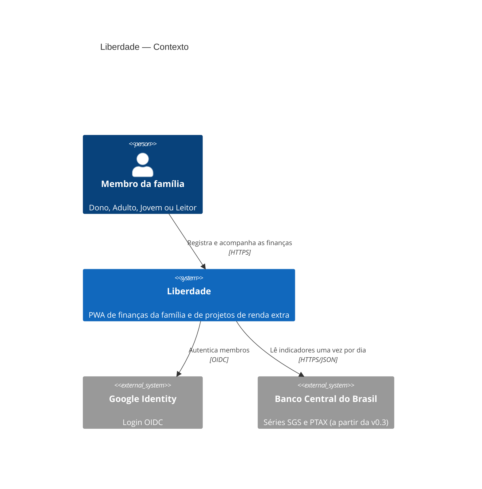
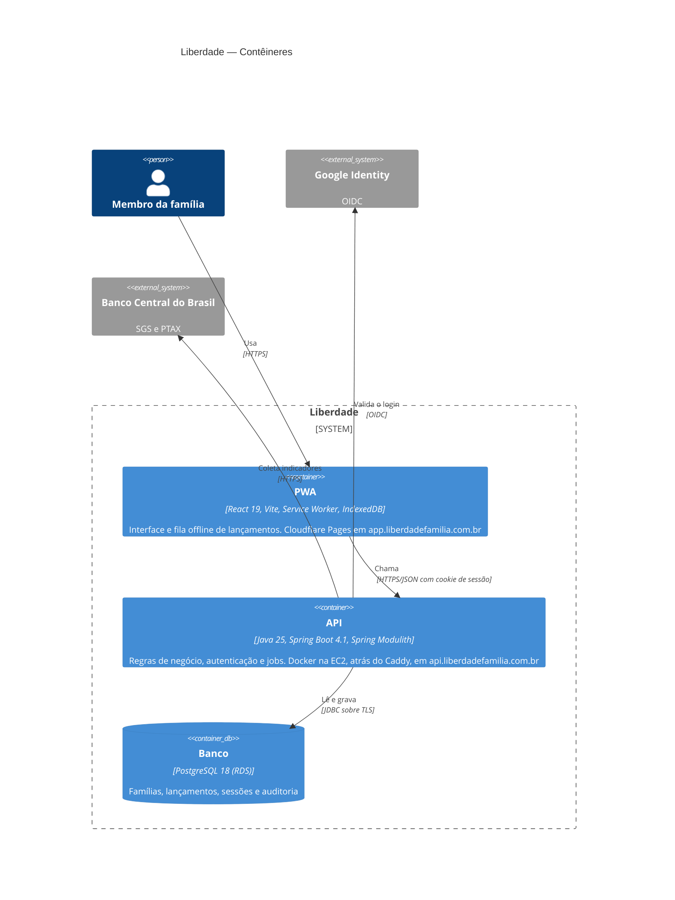
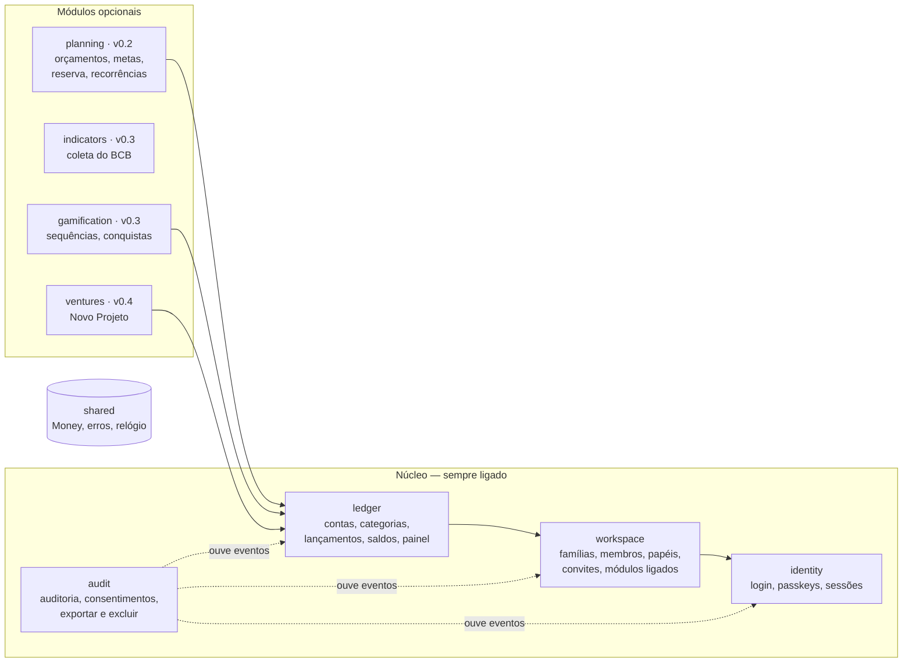
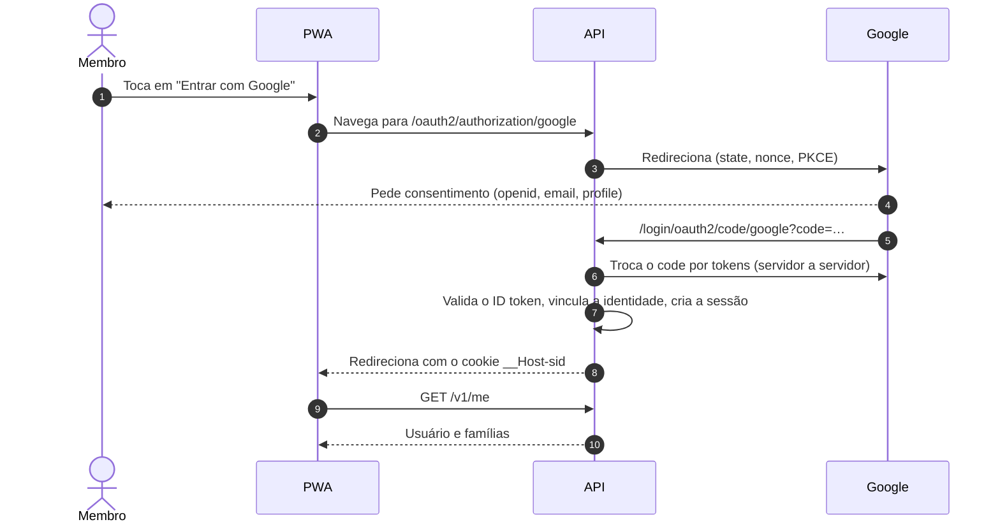
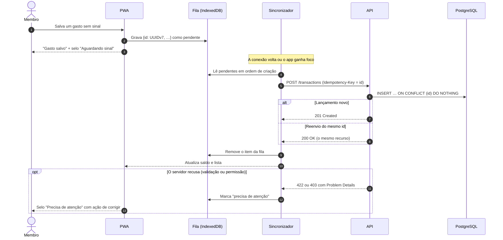
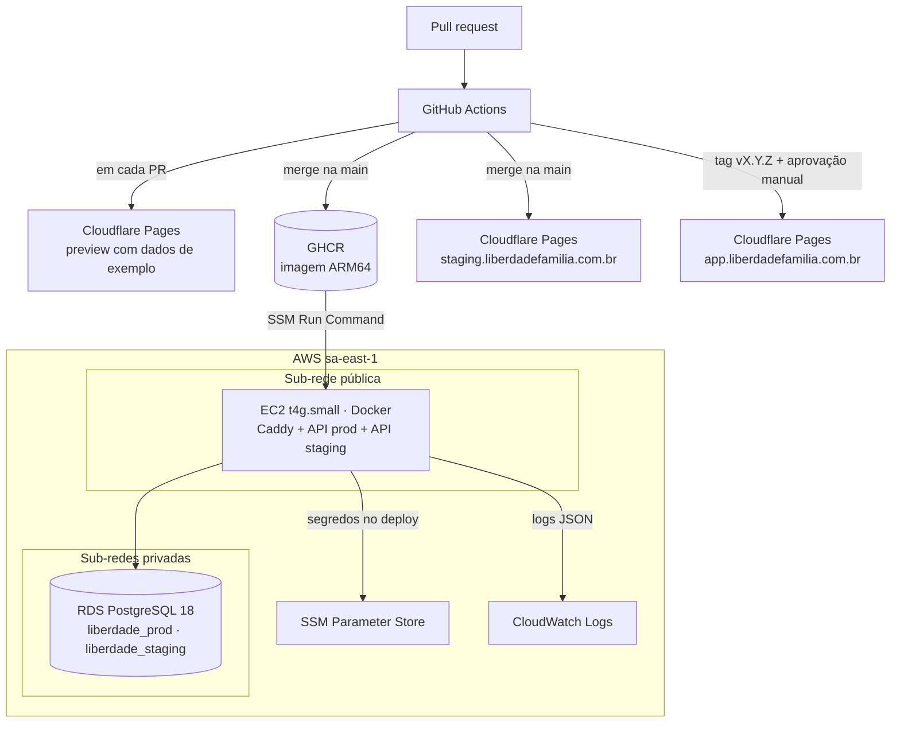

# Arquitetura

> **Status:** rascunho para revisão · **Data:** 2026-11-02 · Diagramas em Mermaid (C4 + fluxos)

## 1. Resumo

- **Front:** PWA em React 19 + Vite + TypeScript, com Service Worker e fila offline em IndexedDB.
  Hospedado no Cloudflare Pages.
- **API:** monólito modular em Java 25 + Spring Boot 4.1 + Spring Modulith, empacotado em Docker
  (ARM64) e rodando em uma EC2 `t4g.small` atrás do Caddy (TLS automático).
- **Banco:** PostgreSQL 18 no RDS (`db.t4g.micro`), criptografado, em sub-rede privada.
- **Região:** AWS `sa-east-1` (São Paulo), dados no Brasil.
- **Sem senha:** login com Google (OIDC) e passkeys (WebAuthn), sessão em cookie `HttpOnly`.

Decisões e alternativas: [ADRs](adr/README.md). Custos: [ADR-0004](adr/0004-hosting-aws-sa-east-1-lean.md).

## 2. Contexto (C4 nível 1)



## 3. Contêineres (C4 nível 2)



## 4. Componentes da API

A API é um **monólito modular**: um único deploy, com módulos isolados por pacote e verificados
pelo Spring Modulith em teste. Cada módulo expõe só o pacote `api` (serviços e eventos); o resto é
interno.



Setas significam "depende de". Regras verificadas por teste:

1. O núcleo **nunca** depende de um módulo opcional. Isso garante o critério S2: desligar um
   módulo nunca quebra o núcleo.
2. Módulos opcionais conversam com o núcleo pela API pública dele ou por eventos de domínio
   (`TransactionRecorded`, `MemberJoined` etc.).
3. Eventos são publicados em memória com o *event publication registry* do Spring Modulith
   (outbox no PostgreSQL): se um ouvinte falhar, o evento é reprocessado. Sem Kafka
   ([ADR-0003](adr/0003-modular-monolith-spring-modulith.md)).
4. `shared` só tem tipos sem regra de negócio de módulo: `Money`, `Problem` (erros) e `Clock`.

### Módulos ligáveis

- A tabela `workspace_modules` guarda o que cada família ligou.
- Endpoints de um módulo desligado respondem `403` com o código `module.disabled`.
- Sequências e conquistas são **derivadas do histórico** de lançamentos, não acumuladas por evento.
  Por isso, religar um módulo recalcula tudo e não deixa buraco.

## 5. Estrutura do front

```
web/src/
  app/          rotas, providers, layout, registro de módulos
  features/
    auth/  onboarding/  transactions/  accounts/  categories/
    dashboard/  members/  modules/  privacy/
    planning/ (v0.2)  indicators/ gamification/ (v0.3)  ventures/ (v0.4)
  shared/
    ui/         componentes do design system (Radix + Tailwind)
    money/      centavos em bigint, formatação com Intl
    offline/    fila IndexedDB (Dexie) e sincronizador
    api/        cliente HTTP, tipos gerados do OpenAPI, Problem Details
    i18n/       mensagens pt-BR
```

- **Dados do servidor:** TanStack Query, com cache persistido para leitura offline.
- **Módulos:** cada feature opcional se registra com `moduleKey`. O registro esconde rotas, menu e
  cards quando o módulo está desligado. Uma feature opcional só importa de `shared/` e da API do
  núcleo, nunca de outra feature opcional (regra de lint).
- **Gráficos:** ECharts (Apache-2.0), carregado sob demanda.

## 6. API v0.1 (resumo)

REST + JSON em `/v1`, contrato OpenAPI 3.1 gerado pela API; o front gera tipos TypeScript a partir
dele. Erros seguem RFC 9457 (Problem Details), com `code` estável e `detail` em pt-BR. Dinheiro
trafega como texto decimal: `{"amount": "1234.56", "currency": "BRL"}`.

| Recurso | Operações |
|---|---|
| Sessão | `GET /oauth2/authorization/google`, endpoints WebAuthn do Spring Security, `POST /logout`, `GET /v1/csrf` |
| Eu | `GET /v1/me`, `POST /v1/me/export`, `POST /v1/me/deletion`, `DELETE /v1/me/deletion`, `GET /v1/me/activity` |
| Famílias | `POST /v1/workspaces`, `GET /v1/workspaces/{ws}`, `PATCH /v1/workspaces/{ws}` |
| Membros | `GET /v1/workspaces/{ws}/members`, `PATCH .../members/{id}` (papel), `DELETE .../members/{id}` |
| Convites | `POST /v1/workspaces/{ws}/invitations`, `DELETE .../invitations/{id}`, `POST /v1/invitations/{token}/accept` |
| Módulos | `GET /v1/workspaces/{ws}/modules`, `PUT .../modules/{key}` |
| Contas | `GET`, `POST`, `PATCH .../accounts/{id}`, `POST .../accounts/{id}/archive` |
| Categorias | `GET`, `POST`, `PATCH .../categories/{id}`, `POST .../categories/{id}/archive` |
| Lançamentos | `GET .../transactions?month=2026-11&accountId=&categoryId=`, `POST` (com `Idempotency-Key`), `PATCH .../transactions/{id}` (com `version`), `DELETE .../transactions/{id}`, `POST .../transactions/{id}/restore` |
| Painel | `GET /v1/workspaces/{ws}/dashboard?month=2026-11` |

Toda rota sob `/v1/workspaces/{ws}` verifica se o usuário é membro ativo de `{ws}` e se o papel
permite a ação (matriz da US-10), negando por padrão.

## 7. Fluxos

### 7.1 Entrar com Google



Passkeys usam o suporte nativo a WebAuthn do Spring Security: registro depois do primeiro login,
ou direto pelo link de convite/recuperação.

### 7.2 Lançar sem internet



Regras do sincronizador:

- **Falha de rede, timeout ou 5xx:** o item continua pendente; nova tentativa com recuo exponencial
  e jitter (2 s, 4 s, 8 s… até 5 min) e sempre que o app ganha foco. O iOS não tem Background Sync,
  por isso o gatilho de foco é obrigatório.
- **401 (sessão expirou):** o item continua pendente; o app pede login e retoma depois.
- **409 com o mesmo `id` e conteúdo diferente:** marca "precisa de atenção" (não deveria acontecer,
  porque o id é gerado no aparelho).
- **Desfazer antes de sincronizar:** remove da fila sem chamar a API.
- Editar e excluir exigem conexão e usam `version` (lock otimista); conflito responde `409` com o
  código `transaction.version-conflict` e a versão atual.

## 8. Implantação



| Ambiente | Front | API | Banco |
|---|---|---|---|
| Local | `localhost:5173` | `localhost:8080` | PostgreSQL 18 em Docker |
| Preview (PR) | `<hash>.<projeto>.pages.dev` | API simulada no navegador (MSW) | — |
| Staging | `staging.liberdadefamilia.com.br` | `api-staging.liberdadefamilia.com.br` | `liberdade_staging` |
| Produção | `app.liberdadefamilia.com.br` | `api.liberdadefamilia.com.br` | `liberdade_prod` |

- **Previews de PR usam dados de exemplo**, não o staging. O domínio `pages.dev` é outro site, e
  o cookie de sessão (`SameSite=Lax`) não iria junto nas chamadas. Para testar com login real,
  usa-se o staging.
- **Staging e produção dividem a EC2 e a instância RDS**, com bancos e usuários de banco separados
  (o usuário do staging não acessa o banco de produção). Esse é o preço do custo baixo: um pico no
  staging pode afetar a produção. Aceitável para uso familiar.
- **Infraestrutura como código** com OpenTofu (MPL-2.0) em `infra/`, para recriar tudo do zero.
- **Migrações** com Flyway, só para frente, no padrão expandir/contrair.
- **Rollback:** reimplantar a tag anterior; migrações são compatíveis com a versão anterior.
- **Caminho para escalar:** trocar a EC2 por ECS Fargate + ALB e ligar Multi-AZ no RDS, sem mudar
  código.

## 9. Segurança

Referência: **OWASP ASVS 5.0, nível 2**, com checklist revisado a cada release.

| Tema | Medida |
|---|---|
| Autenticação | Sem senha: Google OIDC (escopos mínimos, PKCE, `nonce`) e passkeys. O 2FA vem do Google ou da própria passkey. |
| Sessão | Spring Session JDBC (sobrevive a reinícios). Cookie `__Host-sid`: `HttpOnly`, `Secure`, `SameSite=Lax` (o retorno do Google é uma navegação vinda de outro site e precisa levar o cookie). Novo id a cada login; expira após 30 dias sem uso. |
| Reautenticação | Excluir conta, mudar papéis e exportar dados exigem login nos últimos 10 min. |
| CSRF | Token obtido em `GET /v1/csrf`, guardado em memória e enviado em `X-XSRF-TOKEN`; checagem de `Origin`. |
| CORS | Só a origem do front do mesmo ambiente, com credenciais. |
| Autorização | Guarda única por rota: membro ativo + papel; nega por padrão; teste da matriz da US-10 por papel. |
| Isolamento | `workspace_id` em toda tabela, FKs compostas, filtro obrigatório e testes entre famílias ([ADR-0008](adr/0008-workspace-isolation.md)). |
| Limites | Limite de taxa em memória por IP e por usuário em login, convite e recuperação. |
| Entrada | Bean Validation: valor > 0 e ≤ 999.999.999,99; descrição ≤ 140 caracteres. O React escapa a saída. |
| Cabeçalhos | CSP restrita, HSTS, `X-Content-Type-Options`, `Referrer-Policy`, `Permissions-Policy`. |
| Segredos | SSM Parameter Store (SecureString), lidos no deploy; nunca no repositório. Secret scanning com push protection. |
| Infra | EC2 sem SSH (SSM Session Manager), IMDSv2 obrigatório, só 80/443 abertos. RDS em sub-rede privada, acessível só pela EC2, com TLS obrigatório. EBS e RDS criptografados com KMS. GitHub → AWS por OIDC, sem chave fixa. |
| Cadeia de suprimentos | Dependabot, CodeQL, actions fixadas por SHA, `GITHUB_TOKEN` com permissões mínimas. |
| Auditoria | `audit_events` para login, papéis, convites, recuperação, exportação, exclusão e módulos. |
| Logs | JSON, sem valores, descrições ou e-mails (só ids internos); retenção de 30 dias. |

## 10. Observabilidade e operação

- **Saúde:** Spring Boot Actuator (`/actuator/health/liveness` e `/readiness`), usado pelo smoke
  test do deploy.
- **Logs:** driver `awslogs` do Docker → CloudWatch Logs (nível gratuito).
- **Alarmes:** status check da EC2, CPU e espaço livre do RDS (alarmes do nível gratuito).
- **Disponibilidade:** workflow agendado no GitHub Actions chama o `/health` de produção a cada
  15 min e abre uma issue se falhar (grátis em repositório público).
- **Backups:** automáticos do RDS com restauração a qualquer ponto dos últimos 7 dias. Teste de
  restauração no staging a cada release minor.

## 11. Tempo e dinheiro

- Data do lançamento é **data civil** (`LocalDate`), sem hora. Instantes técnicos em UTC
  (`timestamptz`). Fuso da família configurável; padrão `America/Fortaleza`.
- Dinheiro nunca em ponto flutuante: `BigDecimal` na API, `NUMERIC(19,4)` no banco, texto decimal
  no JSON e `bigint` em centavos no front ([ADR-0006](adr/0006-money-representation.md)).
