# Modelo de dados

> **Status:** rascunho para revisão · **Data:** 2026-11-02 · PostgreSQL 18

## 1. Convenções

- Tabelas e colunas em `snake_case`, nomes em inglês, no plural.
- Chave primária `id uuid`. UUIDv7 gerado pelo banco (`uuidv7()`, nativo no PostgreSQL 18), exceto
  em `transactions`, onde o id vem do aparelho (fila offline).
- Toda tabela que pertence a uma família tem `workspace_id` e índices começando por ele.
- FKs para dados da família são **compostas** (`workspace_id`, `id`). Assim o banco impede que um
  lançamento aponte para a conta de outra família ([ADR-0008](adr/0008-workspace-isolation.md)).
- Dinheiro: `NUMERIC(19,4)` + `currency char(3)` (ISO 4217). Na v0.1 só `BRL`.
- Instantes em `timestamptz` (UTC). Datas civis em `date`.
- `created_at`, `updated_at` e `version bigint` (lock otimista) nas tabelas editáveis.
- Enums como `text` com `CHECK`, mais fáceis de evoluir que `ENUM` do PostgreSQL.
- Migrações com Flyway, só para frente.

## 2. v0.1 — Núcleo

```mermaid
erDiagram
  users ||--o{ auth_identities : "entra com"
  users ||--o| user_entities : "identifica no WebAuthn"
  user_entities ||--o{ user_credentials : "tem passkeys"
  users ||--o{ memberships : "participa"
  users ||--o{ consents : "concede"
  workspaces ||--o{ memberships : "tem"
  workspaces ||--o{ invitations : "emite"
  workspaces ||--o{ workspace_modules : "liga"
  workspaces ||--o{ accounts : "tem"
  workspaces ||--o{ categories : "tem"
  workspaces ||--o{ transactions : "tem"
  workspaces ||--o{ audit_events : "registra"
  memberships ||--o{ accounts : "é titular de"
  memberships ||--o{ transactions : "lança"
  accounts ||--o{ transactions : "origem"
  accounts ||--o{ transactions : "destino (transferência)"
  categories ||--o{ transactions : "classifica"
  categories ||--o{ categories : "subcategoria"

  users {
    uuid id PK
    text display_name
    text email "nulo para Jovem sem e-mail"
    text locale "pt-BR"
    timestamptz deletion_requested_at
    timestamptz created_at
  }
  auth_identities {
    uuid id PK
    uuid user_id FK
    text provider "google"
    text subject "sub do ID token"
    timestamptz last_used_at
  }
  user_entities {
    varchar id PK "user handle do WebAuthn"
    varchar name UK "guarda users.id"
    varchar display_name
  }
  user_credentials {
    varchar credential_id PK
    varchar user_entity_user_id FK
    bytea public_key
    bigint signature_count
    boolean backup_eligible
    boolean backup_state
    varchar label "ex.: Celular"
    timestamp created
    timestamp last_used
  }
  workspaces {
    uuid id PK
    text name
    char base_currency "BRL"
    text timezone "America/Fortaleza"
    timestamptz deletion_requested_at
    bigint version
  }
  memberships {
    uuid id PK
    uuid workspace_id FK
    uuid user_id FK "nulo depois que a conta é apagada"
    text role "OWNER ADULT YOUTH VIEWER"
    text nickname
    text status "ACTIVE REMOVED"
    timestamptz parental_consent_at
    uuid parental_consent_by FK
    timestamptz recovered_at "último acesso recuperado"
    timestamptz getting_started_dismissed_at "fechou os primeiros passos"
    bigint version
  }
  invitations {
    uuid id PK
    uuid workspace_id FK
    text kind "INVITE RECOVERY"
    text role
    text nickname "só INVITE"
    uuid target_membership_id FK "só RECOVERY"
    timestamptz parental_consent_at "só convite de Jovem"
    uuid parental_consent_by FK "só convite de Jovem"
    bytea token_hash UK "sha256 do token"
    uuid created_by FK
    timestamptz expires_at
    timestamptz used_at
    uuid used_by FK "quem aceitou (Plano 5)"
    timestamptz revoked_at
  }
  workspace_modules {
    uuid workspace_id PK
    text module_key PK "planning indicators gamification ventures"
    boolean enabled
    uuid updated_by FK
    timestamptz updated_at
  }
  accounts {
    uuid id PK
    uuid workspace_id FK
    text name
    text type "CHECKING SAVINGS CASH CREDIT_CARD WALLET INVESTMENT"
    char currency
    numeric initial_balance
    uuid owner_membership_id FK "titular, opcional"
    timestamptz archived_at
    bigint version
  }
  categories {
    uuid id PK
    uuid workspace_id FK
    uuid parent_id FK
    text kind "INCOME EXPENSE"
    text name
    text icon
    text color
    boolean is_default
    int sort_order
    timestamptz archived_at
    bigint version
  }
  transactions {
    uuid id PK "UUIDv7 gerado no aparelho"
    uuid workspace_id FK
    text kind "INCOME EXPENSE TRANSFER"
    numeric amount "maior que zero"
    char currency
    date occurred_on
    uuid account_id FK
    uuid to_account_id FK "só TRANSFER"
    uuid category_id FK "nulo em TRANSFER"
    text description "até 140 caracteres"
    uuid member_id FK "quem gastou ou recebeu"
    uuid created_by FK
    timestamptz deleted_at
    bigint version
  }
  audit_events {
    uuid id PK
    uuid workspace_id FK
    uuid actor_user_id FK
    text action "ex.: member.role_changed"
    text target_type
    uuid target_id
    jsonb metadata "nunca valores ou descrições"
    timestamptz occurred_at
  }
  consents {
    uuid id PK
    uuid user_id FK
    uuid workspace_id FK "nulo em TERMS e PRIVACY"
    text purpose "PARENTAL, TERMS ou PRIVACY"
    text document_version
    uuid granted_by FK "responsável, no PARENTAL; a própria pessoa nos aceites"
    timestamptz granted_at
    timestamptz revoked_at
    timestamptz superseded_at "versão nova aceita"
  }
```

As tabelas de sessão do Spring Session JDBC (`spring_session`, `spring_session_attributes`) ficam
fora do diagrama.

### Cobrança (Plano 6, migração `V14__billing.sql`)

Três tabelas do módulo `billing`. O valor do pedido e as datas ficam mesmo depois que a família ou
a pessoa são excluídas (contabilidade).

| Tabela | Colunas principais e regras |
|---|---|
| `billing_orders` | `workspace_id` e `requested_by` (nulos, `ON DELETE SET NULL`), `product` (`FOUNDER_2026`), `amount_cents` (`> 0`), `currency` (`BRL`), `status` (`CREATED` `PAID` `EXPIRED` `CANCELED` `REFUND_PENDING` `REFUNDED` `CHARGEBACK`), `asaas_checkout_id` e `asaas_payment_id` (únicos, nulos até o Asaas responder), `paid_at`, `refund_requested_at`, `refunded_at`, `refund_reason` (`CUSTOMER` ou `DUPLICATE`), `created_at`, `updated_at`. Índice único parcial: no máximo um pedido `CREATED` por família |
| `workspace_plans` | Uma linha por família (`workspace_id` é a chave, `ON DELETE CASCADE`): `plan_key` (`FAMILY`), `founder`, `source_order_id` (`ON DELETE SET NULL`), `starts_at`, `ends_at`, `theme` (nulo), `updated_at` |
| `billing_webhook_events` | `event_id` (chave: o `id` do evento do Asaas, que torna a reentrega inofensiva), `event_type`, `checkout_id`, `payment_id`, `received_at`, `processed_at`, `outcome` (`APPLIED` `IGNORED` `UNKNOWN_ORDER` `ERROR`). Guarda só o que a idempotência e o diagnóstico pedem, **nunca o corpo do evento** |

Também na `V14`: o `CHECK` de `audit_events.target_type` ganhou `ORDER` e `PLAN`, e ficou
`USER`, `MEMBERSHIP`, `INVITATION`, `WORKSPACE`, `MODULE`, `CONSENT`, `ORDER` e `PLAN`. As ações
novas são `billing.checkout-started`, `billing.refund-requested`, `plan.activated` e `plan.ended`,
sempre com rótulos fixos nos metadados.

Retenção: eventos do webhook com mais de 180 dias, pedidos nunca pagos com mais de 180 dias e
pedidos pagos com mais de 5 anos são apagados por rotina noturna (às 3h55).

As tabelas de passkey (`user_entities` e `user_credentials`) seguem o schema JDBC do WebAuthn do
Spring Security, por isso fogem das convenções acima. O diagrama mostra só as colunas principais.
`user_entities.name` guarda o `users.id`: é por ele que o Spring liga a passkey à pessoa.

### Plano 7.1 (migrações V15 e V16)

**V15: país, forma de pagamento e tags**

| Tabela | Colunas e regras |
|---|---|
| `workspaces` | Ganha `country` (`char(2)`, padrão `BR`, só `BR` por ora) e `locale` (padrão `pt-BR`, só `pt-BR` por ora). As famílias que já existem são brasileiras |
| `transactions` | Ganha `payment_method` (nulo; `PIX` `CREDIT_CARD` `DEBIT_CARD` `BOLETO` `BANK_TRANSFER` `CASH`). Transferência não tem forma de pagamento (`transactions_transfer_without_payment_method`). Ganha também `UNIQUE (workspace_id, id)`, a chave composta que os vínculos de tag usam |
| `tags` | `id` (UUIDv7), `workspace_id`, `name` (1 a 30 caracteres), `created_by` (vira nulo se o vínculo sair), `created_at`, `archived_at`. Índice único parcial `tags_active_name` em `(workspace_id, lower(name))` onde `archived_at` é nulo: o nome volta a ficar livre depois que a tag é arquivada, e digitá-lo cria uma tag nova |
| `transaction_tags` | `PRIMARY KEY (workspace_id, transaction_id, tag_id)`, com chaves compostas para `transactions` e `tags`, ambas `ON DELETE CASCADE`. Índice `transaction_tags_by_tag` em `(workspace_id, tag_id)` |

**V16: recorrências e previstos**

| Tabela | Colunas e regras |
|---|---|
| `recurring_rules` | `id` (UUIDv7), `workspace_id`, `kind` (`INCOME` `EXPENSE` `TRANSFER`), `amount` (maior que zero), `currency`, `account_id`, `to_account_id` (só `TRANSFER`), `category_id` (nulo em `TRANSFER`), `payment_method`, `description` (1 a 140 caracteres), `frequency` (`WEEKLY` `MONTHLY` `YEARLY`), `interval` (1 a 12), `start_on`, `end_on` (não antes de `start_on`), `next_due_on`, `created_by`, `created_at`, `updated_at`, `archived_at`, `version`. Conta, categoria e autor usam chaves compostas com `workspace_id`; conta de origem e de destino precisam ser diferentes. A regra nunca é apagada pelo app: é arquivada |
| `transactions` | Ganha `status` (`CONFIRMED` por padrão, ou `PLANNED`), `recurring_rule_id` e `scheduled_on`. Quem tem regra precisa ter `scheduled_on`. Se a regra for apagada de vez, o vínculo vira nulo e o histórico confirmado fica |
| Índice | `transactions_one_per_occurrence`, único em `(workspace_id, recurring_rule_id, scheduled_on)` quando há regra: cada ocorrência gera um só lançamento, mesmo o pulado (excluído), e o gerador nunca o refaz |
| `workspace_modules` | A migração liga o módulo `planning` em todas as famílias que já existem; no app, ele já nasce ligado nas novas |
| `audit_events` | `target_type` ganha `RECURRING_RULE` |

Um lançamento `PLANNED` fica em `transactions`, mas nenhuma soma o conta (saldos e painel)
até ele ser confirmado.

### Plano 7.2 (migração V17)

**V17: orçamento, metas e reserva** (`V17__planning.sql`)

| Tabela | Colunas e regras |
|---|---|
| `budgets` | `id` (UUIDv7), `workspace_id`, `category_id`, `month` (sempre o dia 1), `limit_amount` (maior que zero), `currency`, `version`, `created_at`, `updated_at`. Chave composta `(workspace_id, category_id)` para `categories`. `UNIQUE (workspace_id, category_id, month)`: um limite por categoria e mês |
| `goals` | `id` (UUIDv7), `workspace_id`, `name` (1 a 40 caracteres), `target_amount` (maior que zero), `currency`, `due_on` (nulo; mês de prazo, sempre o dia 1), `icon`, `linked_account_id` (nulo), `achieved_at` (nulo), `archived_at` (nulo), `created_by`, `created_at`, `updated_at`, `version`. A conta vinculada e o autor usam chaves compostas com `workspace_id`; se a conta ou o autor sair, a coluna vira nula. `UNIQUE (workspace_id, id)`, a chave que os aportes usam |
| `goal_contributions` | `id` (UUIDv7), `workspace_id`, `goal_id`, `amount` (diferente de zero: positivo guarda, negativo retira), `occurred_on`, `member_id` (vira nulo se a pessoa sair), `created_at`. Chave composta para `goals` com `ON DELETE CASCADE`. Índice `goal_contributions_by_goal` em `(workspace_id, goal_id, occurred_on)` |
| `accounts` | Ganha `is_reserve` (`boolean`, padrão falso): a conta faz parte da reserva de emergência |
| `categories` | Ganha `is_fixed` (`boolean`, padrão falso): a categoria de gasto é um custo fixo |
| `workspaces` | Ganha `reserve_target_months` (`smallint`, de 1 a 24, padrão 6) e `manual_monthly_cost` (nulo, maior que zero): o custo mensal que a família informa quando há pouco histórico |
| `audit_events` | `target_type` ganha `GOAL` |

O progresso de uma meta com conta vinculada é o saldo dessa conta; sem conta, é a soma dos aportes.
Limites, aportes e valores de meta não vão para a auditoria: só o arquivamento de uma meta aparece,
como `GOAL` (`goal.archived`), sem nome nem valor.

Na exportação (v4), `reserveSettings.manualMonthlyCost` vem sem moeda: o valor está na moeda base da
família (`workspaces.currency`), a mesma do resto do cálculo da reserva.

### Plano 8.2 (migrações V19 e V20)

**V19: importação de extrato** (`V19__statement_import.sql`)

| Tabela | O que muda |
|---|---|
| `transactions` | Ganha `import_key` (`text`, nulo, 64 hexadecimais): o SHA-256 de `conta\|data\|valor\|descrição normalizada\|n`. Índice único `(workspace_id, import_key)` onde a chave não é nula, valendo também para os excluídos |
| `import_tombstones` | `workspace_id`, `account_id`, `import_key`, `purged_at`; chave primária `(workspace_id, account_id, import_key)`. Guarda só o hash de um lançamento apagado de vez, sem valor, data nem descrição. Apaga em cascata com a conta e com a família |

Quando o `TransactionPurgeJob` apaga um lançamento importado, copia a chave para
`import_tombstones` na mesma instrução, e o mesmo job apaga os tombstones com mais de 13 meses
(contados em `America/Sao_Paulo`). Assim, uma linha excluída de propósito não volta numa
importação seguinte do mesmo extrato. Editar um lançamento importado mantém a `import_key`.

**V20: auditoria da importação** (`V20__audit_account_target.sql`)

| Tabela | O que muda |
|---|---|
| `audit_events` | `target_type` ganha `ACCOUNT` (`transactions.imported`, alvo = a conta, só as contagens `created`, `confirmed` e `skipped` em `metadata`, sem valores nem descrições) |

Na exportação (v5), cada lançamento ganha `importKey` (nulo quando não veio de um extrato). Os
tombstones não entram: não identificam nada.

### Plano 8.3 (migração V21)

**V21: conquistas** (`V21__achievements.sql`)

| Tabela | O que muda |
|---|---|
| `achievements` | `workspace_id`, `membership_id`, `achievement_key` (o nome da conquista), `earned_at`, `silent` (verdadeiro quando a conquista é concedida sem aviso ao vivo). Chave primária `(membership_id, achievement_key)`: cada participação ganha cada conquista uma vez. Chave composta para `memberships` com `ON DELETE CASCADE`, e para `workspaces` também |
| `transactions` | Índice `transactions_by_creator` em `(workspace_id, created_by, created_at)`, para ler as semanas com lançamentos de cada pessoa |

Na exportação pessoal (v6 em diante), `achievements` traz `workspaceId`, `key` e `earnedAt` de cada conquista de
cada participação da pessoa, as silenciosas também. A exportação da família não muda.

### Regras no banco

| Tabela | Regra |
|---|---|
| `auth_identities` | `UNIQUE (provider, subject)` |
| `memberships` | `UNIQUE (workspace_id, user_id)`; pelo menos um `OWNER` ativo por família (checado na aplicação, com teste) |
| `memberships` | Uma pessoa pode estar em mais de uma família. Índice parcial (não único) em `user_id` com `status = 'ACTIVE'`, para listar as famílias dela |
| Autoria | `memberships.user_id`, `memberships.parental_consent_by`, `invitations.created_by`, `invitations.parental_consent_by`, `workspace_modules.updated_by` e `audit_events.actor_user_id` usam `ON DELETE SET NULL`: apagar a conta de alguém não apaga o que a família registrou |
| `user_entities`, `user_credentials` | `UNIQUE (name)` em `user_entities`; as credenciais são apagadas junto com o `user_entities` (`ON DELETE CASCADE`) |
| `invitations` | Guarda só o **hash** do token; uso único; convite expira em 7 dias e recuperação em 24 h |
| `invitations` | `used_by` aponta para `users` com `ON DELETE SET NULL`: o mesmo convite aceito de novo pela mesma pessoa, já membro ativo, devolve o mesmo resultado em vez de `410` |
| `consents` | `CHECK ((purpose = 'PARENTAL') = (workspace_id IS NOT NULL))`; um registro aberto por pessoa, família e finalidade: índice único `(user_id, workspace_id, purpose) NULLS NOT DISTINCT` com `revoked_at IS NULL AND superseded_at IS NULL` |
| `transactions` | `amount > 0`; `TRANSFER` ⇔ `to_account_id IS NOT NULL` e `category_id IS NULL`; `to_account_id <> account_id`; moeda igual à das contas |
| `transactions` | Reenvio com id já existente: mesma família e mesmo conteúdo → devolve o registro (`200`); qualquer outro caso → `409 transaction.id-conflict`, sem revelar nada do registro existente |
| `transactions` | Índices `(workspace_id, occurred_on)`, `(workspace_id, account_id, occurred_on)` e `(workspace_id, category_id, occurred_on)` |
| `accounts` | Nome único entre as contas ativas da família: índice único parcial em `(workspace_id, name)` com `archived_at IS NULL` |
| `categories` | `color` nula ou uma das 8 cores do design system (`TEAL`, `BLUE`, `INDIGO`, `PURPLE`, `PINK`, `RED`, `ORANGE`, `GREEN`) |
| `categories` | `UNIQUE (workspace_id, kind, parent_id, name)` entre as não arquivadas, porque "Outros" existe nos dois tipos; um só nível de subcategoria |

### Decisões do modelo

- **Transferência é uma linha só** (`account_id` → `to_account_id`), não um par de linhas. Um id
  por transferência deixa a idempotência offline simples, e o total da família não muda por
  construção.
- **Saldo é calculado**, não guardado: `initial_balance` + soma dos lançamentos. Com o volume de uma
  família (milhares de linhas por ano) e os índices acima, a consulta fica bem abaixo de 300 ms. Se
  um dia não ficar, entra um saldo mensal materializado (registrar em ADR).
- **Excluir lançamento é exclusão lógica** (`deleted_at`), para permitir "Desfazer". Um job apaga de
  vez as linhas excluídas há mais de 30 dias. As linhas que uma recorrência fez esperam mais um pouco:
  só saem quando a data prevista é anterior ao primeiro dia do mês passado, para que o gerador não
  as recrie (o gerador nunca planeja antes do dia 1 do mês atual).
- **Membro removido** vira `status = REMOVED`; os lançamentos dele continuam na família, com o
  apelido.
- **Jovem** pode não ter e-mail (`users.email` nulo) e entra só por passkey. O consentimento
  parental dado no convite é copiado para `memberships` e `consents` (`PARENTAL`) quando o convite
  é aceito. Revogar esse consentimento tira o Jovem da família.
- **Aceite dos termos e da política** (Plano 5) fica em `consents` com `purpose` `TERMS` ou
  `PRIVACY`, sem família, com a versão aceita. A base legal do serviço é a execução de contrato
  (LGPD art. 7º, V); o aceite registra que a pessoa foi informada e concordou. Uma versão nova
  fecha a anterior com `superseded_at`. O aceite não se revoga pelo app: quem não concorda mais
  exclui a conta.
- **Conta apagada de vez**: os vínculos viram `REMOVED` com `user_id` nulo, e os lançamentos ficam
  com o apelido. As passkeys (`user_entities`), as sessões, as identidades e os consentimentos da
  pessoa são apagados.
- **Família excluída de vez**: tudo dela vai em cascata. Os eventos de auditoria ficam com
  `workspace_id` nulo até vencer o prazo de retenção.

## 3. v0.2 — Planejamento

| Tabela | Colunas principais |
|---|---|
| `budgets` | `workspace_id`, `category_id`, `month` (1º dia do mês), `limit_amount`, `currency`, `version`; `UNIQUE (workspace_id, category_id, month)` |
| `goals` | `workspace_id`, `name`, `target_amount`, `currency`, `due_on`, `icon`, `linked_account_id` (opcional), `achieved_at`, `archived_at`, `version` |
| `goal_contributions` | `workspace_id`, `goal_id`, `amount`, `occurred_on`, `member_id` (aportes manuais quando não há conta vinculada) |
| Alterações | `accounts.is_reserve`; `workspaces.reserve_target_months` (padrão 6) e `workspaces.manual_monthly_cost` |

`recurring_rules`, `tags`, `transaction_tags`, `transactions.status` e `transactions.recurring_rule_id` já existem desde o Plano 7.1 (ver [Plano 7.1](#plano-71-migrações-v15-e-v16)).

Lançamentos `PLANNED` não entram em saldos nem no painel até serem confirmados.

## 4. v0.3 — Indicadores e gamificação

| Tabela | Colunas principais |
|---|---|
| `indicator_series` | `code` (ex.: `SELIC_TARGET`), `source` (`BCB_SGS` `BCB_PTAX`), `source_ref` (ex.: `432`), `unit`, `name` |
| `indicator_points` | `series_code`, `ref_date`, `value numeric(19,6)`, `fetched_at`, `source_url`; `UNIQUE (series_code, ref_date)` |
| `achievements` | `workspace_id`, `membership_id`, `achievement_key`, `earned_at`; `UNIQUE (membership_id, achievement_key)` |

No Plano 8.1 (migração V18), `indicator_series` ganhou `last_success_at`, `last_failure_at` e
`failure_streak` (a saúde de cada coleta) e já nasce com as cinco séries: `SELIC_TARGET` (432),
`CDI` (4389), `IPCA_MONTH` (433), `IPCA_12M` (13522) e `USD_PTAX_SELL` (PTAX). Nenhuma das duas
tabelas tem `workspace_id`: nada delas entra na exportação nem na exclusão de conta.

Sequências não têm tabela: são calculadas a partir das semanas com lançamentos (seção 4 da
[arquitetura](architecture.md#4-componentes-da-api)). Indicadores não pertencem a uma família e não
têm `workspace_id`.

## 5. v0.4 — Novo Projeto

**V30: projetos** (`V30__ventures.sql`, Plano 9.1)

| Tabela | Colunas principais |
|---|---|
| `ventures` | `workspace_id`, `name` (1 a 40 letras), `type` (`FOOD` `DIGITAL_PRODUCT` `CONTENT` `RESALE` `SERVICE` `OTHER`), `template_key` (o modelo de origem; vazio num projeto em branco), `status` (`PLANNING` `ACTIVE` `PAUSED` `CLOSED`), `started_on`, `closed_on`, `currency` (a moeda da família na criação), `created_by` (opcional), `version` |
| `venture_cost_items` | `workspace_id`, `venture_id`, `kind` (`INITIAL` `FIXED_MONTHLY`), `name`, `amount`, `currency`, `is_example`, `position` |
| `venture_products` | `workspace_id`, `venture_id`, `name`, `unit_variable_cost`, `unit_price`, `planned_units_month`, `currency`, `is_example`, `position` |
| `venture_steps` | `workspace_id`, `venture_id`, `title`, `position`, `done_at` |

Regras no banco: fora de `PLANNING` o projeto precisa de `started_on`; `closed_on` existe só em `CLOSED` e
não vem antes de `started_on`. Os itens, produtos e passos somem com o projeto, e o projeto some com a
família. `created_by` é chave composta para `memberships` com `ON DELETE SET NULL (created_by)`: quem sai
da família deixa os projetos para trás, sem autor. A tabela `audit_events` passou a aceitar o alvo `VENTURE`.

`transactions.venture_id` (opcional, para ligar vendas e custos reais ao projeto) ainda não existe.

**Exportação (v7).** A exportação pessoal traz em `ventures` os projetos criados pela pessoa, com itens,
produtos e passos. A exportação da família traz todos os projetos no JSON e quatro planilhas:
`projetos.csv`, `projetos_itens.csv`, `projetos_produtos.csv` e `projetos_passos.csv`. A exportação
pessoal não tem planilha de projetos. Quem sai da família leva só o que criou; os projetos ficam com a
família.

## 6. Retenção (LGPD)

| Dado | Retenção |
|---|---|
| Conta excluída | 30 dias de carência e depois apagamento definitivo |
| Família excluída | 30 dias de carência e depois apagamento definitivo |
| Lançamento excluído | Apagado de vez após 30 dias; o de uma recorrência (excluído ou pulado) espera também até o segundo mês depois da data prevista |
| Convites usados ou vencidos | Apagados após 90 dias |
| `ventures` | Ficam com a família; ao sair, o autor vira vazio (`created_by` nulo). Somem com a família |
| `achievements` | Somem com a participação: ao sair da família, ao excluir a conta ou com a família |
| `import_tombstones` | 13 meses depois do apagamento definitivo do lançamento (só o hash); apagados junto com a conta bancária ou a família |
| `billing_webhook_events` | 180 dias |
| `billing_orders` | Nunca pagos: 180 dias. Pagos: 5 anos (contabilidade), mesmo sem a família |
| `audit_events` | 12 meses |
| Backups do RDS | 7 dias (o apagamento definitivo alcança os backups nesse prazo) |
| Logs da aplicação | 30 dias, sem dados financeiros |
