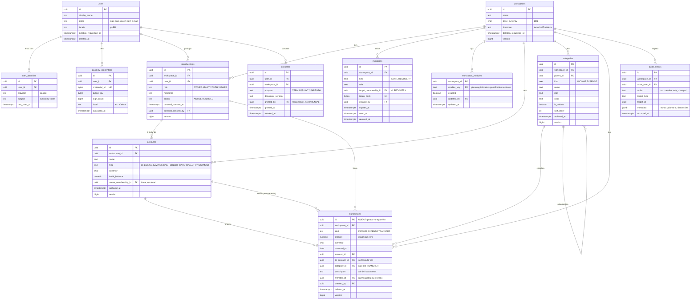

# Modelo de dados

> **Status:** rascunho para revisão · **Data:** 2026-11-02 · PostgreSQL 18

## 1. Convenções

- Tabelas e colunas em `snake_case`, nomes em inglês, no plural.
- Chave primária `id uuid`. UUIDv7 gerado pelo banco (`uuidv7()`, nativo no PostgreSQL 18), exceto
  em `transactions`, onde o id vem do aparelho (fila offline).
- Toda tabela que pertence a uma família tem `workspace_id` e índices começando por ele.
- FKs para dados da família são **compostas** (`workspace_id`, `id`). Assim o banco impede que um
  lançamento aponte para a conta de outra família ([ADR-0008](adr/0008-workspace-isolation.md)).
- Dinheiro: `NUMERIC(19,4)` + `currency char(3)` (ISO 4217). Na v0.1 só `BRL`.
- Instantes em `timestamptz` (UTC). Datas civis em `date`.
- `created_at`, `updated_at` e `version bigint` (lock otimista) nas tabelas editáveis.
- Enums como `text` com `CHECK`, mais fáceis de evoluir que `ENUM` do PostgreSQL.
- Migrações com Flyway, só para frente.

## 2. v0.1 — Núcleo

As tabelas de sessão do Spring Session JDBC (`spring_session`, `spring_session_attributes`) ficam
fora do diagrama.

### Regras no banco

| Tabela | Regra |
|---|---|
| `auth_identities` | `UNIQUE (provider, subject)` |
| `memberships` | `UNIQUE (workspace_id, user_id)`; pelo menos um `OWNER` ativo por família (checado na aplicação, com teste) |
| `invitations` | Guarda só o **hash** do token; uso único; convite expira em 7 dias e recuperação em 24 h |
| `transactions` | `amount > 0`; `TRANSFER` ⇔ `to_account_id IS NOT NULL` e `category_id IS NULL`; `to_account_id <> account_id`; moeda igual à das contas |
| `transactions` | Índices `(workspace_id, occurred_on)`, `(workspace_id, account_id, occurred_on)` e `(workspace_id, category_id, occurred_on)` |
| `categories` | `UNIQUE (workspace_id, parent_id, name)` entre as não arquivadas; um só nível de subcategoria |

### Decisões do modelo

- **Transferência é uma linha só** (`account_id` → `to_account_id`), não um par de linhas. Um id
  por transferência deixa a idempotência offline simples, e o total da família não muda por
  construção.
- **Saldo é calculado**, não guardado: `initial_balance` + soma dos lançamentos. Com o volume de uma
  família (milhares de linhas por ano) e os índices acima, a consulta fica bem abaixo de 300 ms. Se
  um dia não ficar, entra um saldo mensal materializado (registrar em ADR).
- **Excluir lançamento é exclusão lógica** (`deleted_at`), para permitir "Desfazer". Um job apaga de
  vez as linhas excluídas há mais de 30 dias.
- **Membro removido** vira `status = REMOVED`; os lançamentos dele continuam na família, com o
  apelido.
- **Jovem** pode não ter e-mail (`users.email` nulo) e entra só por passkey.

## 3. v0.2 — Planejamento

| Tabela | Colunas principais |
|---|---|
| `budgets` | `workspace_id`, `category_id`, `month` (1º dia do mês), `limit_amount`, `currency`, `version`; `UNIQUE (workspace_id, category_id, month)` |
| `goals` | `workspace_id`, `name`, `target_amount`, `currency`, `due_on`, `icon`, `linked_account_id` (opcional), `achieved_at`, `archived_at`, `version` |
| `goal_contributions` | `workspace_id`, `goal_id`, `amount`, `occurred_on`, `member_id` (aportes manuais quando não há conta vinculada) |
| `recurring_rules` | `workspace_id`, molde do lançamento (tipo, valor, conta, categoria, descrição), `frequency` (`WEEKLY` `MONTHLY` `YEARLY`), `interval`, `start_on`, `end_on`, `next_due_on` |
| `tags`, `transaction_tags` | Tags livres por família e vínculo com lançamentos |
| Alterações | `accounts.is_reserve`; `transactions.status` (`CONFIRMED` `PLANNED`) e `transactions.recurring_rule_id`; `workspaces.reserve_target_months` (padrão 6) e `workspaces.manual_monthly_cost` |

Lançamentos `PLANNED` não entram em saldos nem no painel até serem confirmados.

## 4. v0.3 — Indicadores e gamificação

| Tabela | Colunas principais |
|---|---|
| `indicator_series` | `code` (ex.: `SELIC_TARGET`), `source` (`BCB_SGS` `BCB_PTAX`), `source_ref` (ex.: `432`), `unit`, `name` |
| `indicator_points` | `series_code`, `ref_date`, `value numeric(19,6)`, `fetched_at`, `source_url`; `UNIQUE (series_code, ref_date)` |
| `achievements` | `workspace_id`, `membership_id`, `achievement_key`, `earned_at`; `UNIQUE (membership_id, achievement_key)` |

Sequências não têm tabela: são calculadas a partir das semanas com lançamentos (seção 4 da
[arquitetura](architecture.md#4-componentes-da-api)). Indicadores não pertencem a uma família e não
têm `workspace_id`.

## 5. v0.4 — Novo Projeto

| Tabela | Colunas principais |
|---|---|
| `ventures` | `workspace_id`, `name`, `type` (`FOOD` `DIGITAL_PRODUCT` `SERVICE` `OTHER`), `template_key`, `status` (`PLANNING` `ACTIVE` `PAUSED` `CLOSED`), `started_on`, `version` |
| `venture_cost_items` | `workspace_id`, `venture_id`, `kind` (`INITIAL` `FIXED_MONTHLY`), `name`, `amount`, `currency` |
| `venture_products` | `workspace_id`, `venture_id`, `name`, `unit_variable_cost`, `unit_price`, `planned_units_month` |
| Alterações | `transactions.venture_id` (opcional) liga vendas e custos reais ao projeto |

## 6. Retenção (LGPD)

| Dado | Retenção |
|---|---|
| Conta excluída | 30 dias de carência e depois apagamento definitivo |
| Lançamento excluído | Apagado de vez após 30 dias |
| Convites usados ou vencidos | Apagados após 90 dias |
| `audit_events` | 12 meses |
| Backups do RDS | 7 dias (o apagamento definitivo alcança os backups nesse prazo) |
| Logs da aplicação | 30 dias, sem dados financeiros |
