# Roadmap

> **Status:** rascunho para revisão · **Data:** 2026-11-17
>
> Cada fase termina em algo usável pela família. Tamanhos são relativos (P, M, G) e o plano de
> implementação de cada fase transforma isso em tarefas. Valores em BRL com dólar PTAX de venda de
> R$ 5,42 (30/10/2026), salvo onde outra data é indicada.
>
> **Mudança de 2026-11-17:** a cobrança veio para logo depois da v0.1 (Plano 6), para haver receita
> antes de os créditos da AWS acabarem ([ADR-0015](adr/0015-revenue-model-and-billing.md), proposto).
> A abertura para outras famílias vem junto, antes da v0.4.

## Visão geral

```mermaid
flowchart LR
  f0[Fase 0<br/>Fundação] --> v01[v0.1<br/>Núcleo]
  v01 --> p6[Plano 6<br/>Cobrança]
  p6 --> v02[v0.2<br/>Planejamento]
  v02 --> v03[v0.3<br/>Indicadores e jogo]
  v03 --> v04[v0.4<br/>Trilhas de renda extra]
  v04 --> p10[Plano 10<br/>Feira]
  p10 --> f2[Fase 2<br/>Construtor]
  f2 --> f3[Fase 3<br/>IA e trilhas]
  f3 --> f4[Fase 4<br/>Dados externos]
  f4 --> f5[Fase 5<br/>Social]
  f5 --> f6[Fase 6<br/>Lojas e países]
```

## Fase 0 — Fundação (P)

- Repositório público com licença AGPL-3.0, README, CONTRIBUTING, templates, CODEOWNERS.
- CI no PR: lint, formatação, typecheck, testes, cobertura, build, CodeQL, commitlint e preview.
- `main` protegida, Dependabot, secret scanning com push protection, release-please.
- GitHub Projects com as issues RF-01 a RF-14.
- Ambiente local com Docker Compose (PostgreSQL 18) e esqueleto da API e do PWA.

**Sai quando:** um PR de exemplo passa no CI e gera preview. **Custo:** R$ 0.

## Fase 1 — MVP

### v0.1 Núcleo (G)

Login sem senha, família e convites, papéis, contas, categorias, receitas, gastos e
transferências (com fila offline), saldo, painel do mês, onboarding em 60 s, módulos ligáveis,
exportar e excluir conta, auditoria.

**Sai quando:**
- os critérios S1, S2, S4 e S5 do [PRD](prd.md#3-critérios-de-sucesso) passam;
- o E2E "entrar → criar família → 1º gasto em menos de 60 s" passa, inclusive em modo avião;
- a política de privacidade está publicada;
- a AWS foi ligada (último passo da v0.1), com staging e produção no ar;
- a família usa por 2 semanas.

**Custo a partir daqui:** ≈ R$ 329/mês (AWS ≈ R$ 326 + domínio ≈ R$ 3; DNS no Cloudflare, grátis),
ou ≈ R$ 228/mês com instâncias reservadas por 1 ano. Os créditos de conta nova da AWS (até
US$ 200 ≈ R$ 1.146) cobrem cerca de 3,5 meses. Preços de 16/11/2026 com PTAX de R$ 5,7324
([ADR-0014](adr/0014-dns-cloudflare-and-costs.md), que atualiza a
[ADR-0004](adr/0004-hosting-aws-sa-east-1-lean.md)).

### Plano 6 — Cobrança e Retrato do mês (M)

Planos Grátis e Família, pré-venda Família Fundadora, assinatura por Pix ou cartão num processador
de pagamento (o app nunca guarda dados de cartão), cancelamento em um clique e reembolso em 7 dias.
Junto vem o **Retrato do mês**: um cartão compartilhável com o resumo do mês só em percentuais, sem
valores, gerado no aparelho.

**Sai quando:**
- uma família consegue assinar, cancelar e pedir reembolso no staging, com o processador em modo
  de teste;
- o plano Grátis continua completo para o uso do dia a dia (S2 passa sem assinatura);
- um contador confirmou o CNPJ e o enquadramento, e os termos de uso trazem reembolso e
  cancelamento.

**Custo:** R$ 0 fixo; só a taxa por transação do processador. Ponto de equilíbrio: 24 famílias no
mensal de R$ 14,90 no cartão, ou 34 no anual de R$ 119 no Pix (ADR-0015, taxas de 16/11/2026).

### v0.2 Planejamento (M) — Plano 7

Orçamento por categoria com avisos gentis, metas da família, reserva de emergência, recorrências
previstas, tags. Também:

- **sincronização ao vivo** entre os aparelhos da família (SSE): o gasto de um aparece na tela do
  outro sem recarregar;
- **forma de pagamento** em cada lançamento (Pix, crédito, débito, boleto, TED, dinheiro);
- **país, moeda base e idioma** no modelo da família, para não precisar migrar dados depois. A
  interface continua só em PT-BR e BRL até a Fase 6;
- a base de **movimento e som** do [design system](design-system.md#5-movimento-e-som).

**Sai quando:** os exemplos das seções 7.3 a 7.5 do PRD passam como teste e a família fecha um mês
com orçamento.

### v0.3 Indicadores e gamificação (M) — Plano 8

Selic, CDI, IPCA e dólar com fonte e data; calculadora de rendimento real; sequência semanal,
conquistas e celebrações. Também:

- **dicas no contexto e tours curtos**, que a pessoa pode desligar;
- **importação de extrato OFX e CSV**, revisada antes de gravar. É a alternativa sem custo ao Open
  Finance.

**Sai quando:** a coleta diária roda por 2 semanas sem falha silenciosa; S3 passa; o aviso da CVM
aparece em toda tela de indicadores; um extrato real de cada banco da família entra sem duplicar
lançamentos.

### v0.4 Trilhas de renda extra (M) — Plano 9

Projeto de renda extra com custos, preço, margem, ponto de equilíbrio, ROI, payback e real vs.
planejado, agora organizado em **trilhas**: culinária, produtos digitais, conteúdo, revenda e
serviços. Cada trilha traz um modelo pronto e passos curtos. Uma trilha de investimentos entra só
como conteúdo educativo, com o aviso da CVM.

**Sai quando:** o exemplo da seção 7.7 do PRD passa como teste e um projeto real da família é
acompanhado por 1 mês.

**Payback do app:** o primeiro mês em que ele ajudar a família a evitar pelo menos R$ 329 em gastos
(≈ 3% de uma renda de R$ 10 mil). ROI mensal = (economia − 329) ÷ 329; por exemplo, R$ 500
economizados dão ≈ 52%.

### Plano 10 — Feira (M)

Mercados perto de casa e comparação de preços, como recurso do plano Família.

- **Mercados:** dados do OpenStreetMap, em cache semanal, com a atribuição da licença ODbL.
- **Onde a família está:** a localização do aparelho (precisa, aproximada ou manual, com permissão)
  ou o endereço da família.
- **Lista com distâncias.** O mapa do Google (Maps Embed) só carrega quando a pessoa toca; antes
  disso, nada vai para o Google. Links para abrir no Maps ou no Waze.
- **Cartão do mercado:** site, Instagram (oEmbed, também só ao tocar) e o encarte, quando houver.
- **Preços:** primeiro pelo QR da NFC-e que a própria família escaneia. Scraping só onde os termos
  de uso e o robots.txt permitirem, com cache, limite de requisições e identificação do bot.
- A CSP libera `frame-src` só para os embeds usados.

**Sai quando:** a família compara uma lista real em 2 mercados e o mapa não carrega nada sem um
toque.

## Fases seguintes (cada uma com spec próprio)

| Fase | Conteúdo | Riscos e pré-requisitos |
|---|---|---|
| 2 Construtor | Construtor com fórmulas reativas (RF-03), biblioteca de renda extra (RF-09), grupos e organizações, níveis e desafios da família | Avaliar HyperFormula (GPLv3, compatível com AGPL) ou motor próprio |
| 3 IA e trilhas | Agente de IA (RF-11), trilhas de aprendizagem (RF-06), modo Dicas, guias passo a passo. Pode ser recurso pago | Custo por uso da IA em BRL; conteúdo educativo, nunca recomendação (CVM) |
| 4 Dados externos | Multimoeda, investimentos e cripto como conteúdo educativo (RF-02, RF-08), ranking de bancos (RF-07), referências (RF-10), notícias, Open Finance quando houver receita para ele | Conferir a norma vigente da CVM; scraping só onde termos e robots.txt permitirem; o agregador custa a partir de R$ 2.500/mês (ADR-0015) |
| 5 Social | Redes sociais via OAuth (RF-13); mapa de preços compartilhado e anônimo entre famílias | Escopos mínimos, consentimento por membro e revogação; anonimização revisada antes de abrir |
| 6 Lojas e países | Capacitor (Android/iOS), Tauri (desktop); EUA, Canadá e Europa com idiomas, moedas e formas de pagamento locais; cobrança na moeda local | GDPR e PIPEDA além da LGPD; marca no INPI e fora do Brasil; regras das lojas para cobrança |
