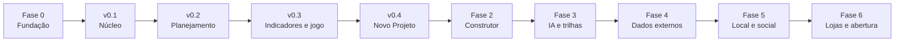

# Roadmap

> **Status:** rascunho para revisão · **Data:** 2026-11-02
>
> Cada fase termina em algo usável pela família. Tamanhos são relativos (P, M, G) e o plano de
> implementação de cada fase transforma isso em tarefas. Valores em BRL com dólar PTAX de venda de
> R$ 5,42 (30/10/2026).

## Visão geral

## Fase 0 — Fundação (P)

- Repositório público com licença AGPL-3.0, README, CONTRIBUTING, templates, CODEOWNERS.
- CI no PR: lint, formatação, typecheck, testes, cobertura, build, CodeQL, commitlint e preview.
- `main` protegida, Dependabot, secret scanning com push protection, release-please.
- GitHub Projects com as issues RF-01 a RF-14.
- Ambiente local com Docker Compose (PostgreSQL 18) e esqueleto da API e do PWA.

**Sai quando:** um PR de exemplo passa no CI e gera preview. **Custo:** R$ 0.

## Fase 1 — MVP

### v0.1 Núcleo (G)

Login sem senha, família e convites, papéis, contas, categorias, receitas, gastos e
transferências (com fila offline), saldo, painel do mês, onboarding em 60 s, módulos ligáveis,
exportar e excluir conta, auditoria.

**Sai quando:**
- os critérios S1, S2, S4 e S5 do [PRD](prd.md#3-critérios-de-sucesso) passam;
- o E2E "entrar → criar família → 1º gasto em menos de 60 s" passa, inclusive em modo avião;
- a política de privacidade está publicada;
- a AWS foi ligada (último passo da v0.1), com staging e produção no ar;
- a família usa por 2 semanas.

**Custo a partir daqui:** ≈ R$ 311/mês (AWS ≈ R$ 304 + domínio e DNS ≈ R$ 7), ou ≈ R$ 220/mês com
instâncias reservadas por 1 ano. Os créditos de conta nova da AWS (até US$ 200 ≈ R$ 1.084) cobrem
cerca de 3,5 meses ([ADR-0004](adr/0004-hosting-aws-sa-east-1-lean.md)).

### v0.2 Planejamento (M)

Orçamento por categoria com avisos gentis, metas da família, reserva de emergência, recorrências
previstas, tags.

**Sai quando:** os exemplos das seções 7.3 a 7.5 do PRD passam como teste e a família fecha um mês
com orçamento.

### v0.3 Indicadores e gamificação (M)

Selic, CDI, IPCA e dólar com fonte e data; calculadora de rendimento real; sequência semanal,
conquistas e celebrações.

**Sai quando:** a coleta diária roda por 2 semanas sem falha silenciosa; S3 passa; o aviso da CVM
aparece em toda tela de indicadores.

### v0.4 Novo Projeto (M)

Projeto de renda extra com custos, preço, margem, ponto de equilíbrio, ROI, payback, real vs.
planejado e 3 modelos prontos.

**Sai quando:** o exemplo da seção 7.7 do PRD passa como teste e um projeto real da família é
acompanhado por 1 mês.

**Payback do app:** o primeiro mês em que ele ajudar a família a evitar pelo menos R$ 311 em gastos
(≈ 3% de uma renda de R$ 10 mil). ROI mensal = (economia − 311) ÷ 311; por exemplo, R$ 500
economizados dão ≈ 61%.

## Fases seguintes (cada uma com spec próprio)

| Fase | Conteúdo | Riscos e pré-requisitos |
|---|---|---|
| 2 Construtor | Construtor com fórmulas reativas (RF-03), biblioteca de renda extra (RF-09), grupos e organizações, níveis e desafios | Avaliar HyperFormula (GPLv3, compatível com AGPL) ou motor próprio |
| 3 IA e trilhas | Agente de IA (RF-11), trilhas de aprendizagem (RF-06), modo Dicas, guias passo a passo | Custo por uso da IA em BRL; conteúdo educativo, nunca recomendação (CVM) |
| 4 Dados externos | Multimoeda, investimentos e cripto (RF-02, RF-08), ranking de bancos (RF-07), referências (RF-10), notícias | Conferir a norma vigente da CVM; scraping só onde termos e robots.txt permitirem |
| 5 Local e social | Geolocalização e preços (RF-12), redes sociais via OAuth (RF-13) | Permissão de localização (precisa, aproximada ou manual); escopos mínimos; revogação |
| 6 Lojas e abertura | Capacitor (Android/iOS), Tauri (desktop), outros idiomas, abertura para outras famílias, possível monetização | Revisão de LGPD, marca no INPI e custos por família |
