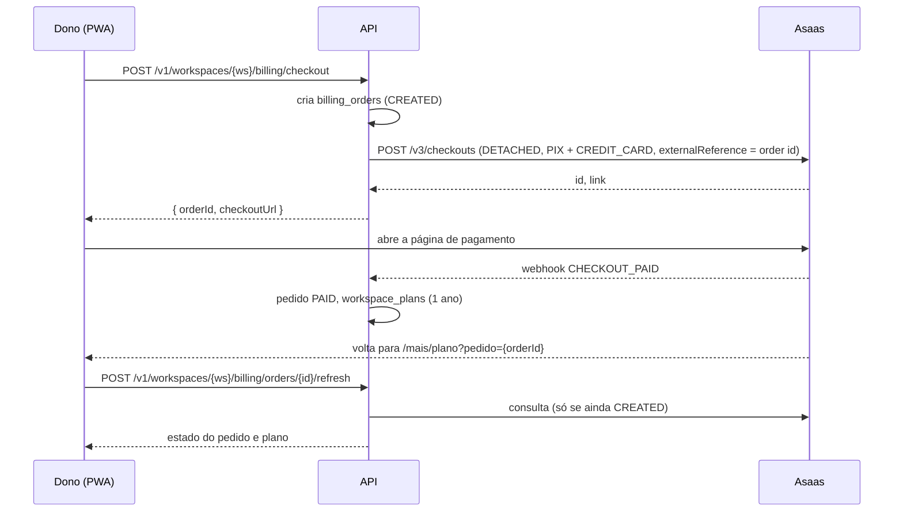

# Plano 6 — Cobrança e Retrato do mês: design

> **Status:** aprovado pelo mantenedor em 2026-11-17 · **Data:** 2026-11-17
>
> Base: `main` em 33bbbe7 (PR #41), [ADR-0015](../../adr/0015-revenue-model-and-billing.md),
> [PRD US-14 a US-17](../../prd.md#plano-6--cobrança-e-retrato-do-mês) e o
> [roadmap](../../roadmap.md#plano-6--cobrança-e-retrato-do-mês-m) revisto em 2026-11-17. As
> decisões de produto vieram do mantenedor, uma a uma, em 2026-11-17. O que está marcado como
> **(proposta)** foi apresentado sem objeção, mas não foi aprovado de forma explícita. O que está
> marcado como **(decisão do design)** é escolha minha, para o mantenedor conferir ao ler. Um
> revisor leu o spec contra o código; o que ele levantou está resolvido na seção 5 (decisões 6 a
> 9, do mantenedor) e nas seções 6.1, 6.2, 6.8 e 6.9.

## 1. Intenção e porquê

A infra custa ≈ R$ 329/mês, e os créditos da AWS cobrem cerca de 3,5 meses. O Plano 6 existe para
haver **receita antes de os créditos acabarem**, sem trair o que o app promete: privacidade, nada de
pressão para gastar e um plano Grátis que dá conta do dia a dia.

Hoje quase nada do que o plano Família vai incluir existe: mesada e missões, metas ilimitadas,
importação de extrato e Feira chegam da v0.2 em diante, e o papel Jovem já é grátis. Cobrar uma
mensalidade agora seria vender o que ainda não existe. Por isso o Plano 6 abre **só a pré-venda
Família Fundadora**: quem acredita no projeto paga um ano adiantado, com desconto e preço travado, e
recebe cada recurso pago assim que ele sair.

O **Retrato do mês** entra junto como o primeiro motivo para alguém de fora conhecer o app: um
cartão bonito, só com percentuais, que a família compartilha se quiser.

## 2. Objetivos, não-objetivos e antiobjetivos

**Objetivos**
- O Dono de uma família compra a Família Fundadora por R$ 89, por Pix ou cartão, na página do
  Asaas, e a família vira Fundadora em segundos depois da confirmação do pagamento.
- Nos 7 primeiros dias, o Dono pede o reembolso integral em um toque, e o dinheiro volta pelo
  próprio Asaas.
- Qualquer membro gera o Retrato do mês no aparelho e compartilha pelo menu do sistema ou baixa a
  imagem.
- O código de cobrança (módulo, webhook, plano por família, `@RequiresPlan`) fica pronto para o
  mensal e o anual da v0.2 e da v0.3 sem refazer nada.
- Tudo testado no **sandbox** do Asaas, no staging, antes de existir chave de produção.

**Não-objetivos (ficam para depois)**
- Mensal de R$ 14,90 e anual de R$ 119, recorrência, Pix Automático e renovação. A renovação da
  Fundadora só é necessária daqui a ≈ 11 meses e entra com o mensal **(proposta)**.
- Recursos pagos de verdade. No Plano 6 a Fundadora ganha só o tema de cor e o selo; o resto chega
  com cada plano seguinte.
- Cupom, indicação, parcelamento, boleto, nota fiscal emitida pelo app (o Asaas emite).
- Outras moedas e países (Fase 6).

**Antiobjetivos (o Plano 6 falhou, mesmo funcionando, se...)**
- ...houver contagem regressiva, "últimas vagas", aviso de compra no meio de um lançamento ou
  qualquer insinuação de que os dados somem sem pagar.
- ...o plano Grátis perder qualquer coisa que exista hoje (S2 tem de passar sem compra).
- ...o app guardar CPF, cartão ou endereço de quem paga.
- ...a família virar Fundadora sem o pagamento confirmado pelo Asaas, ou pagar e não virar.
- ...o Retrato mandar qualquer dado para o servidor ou mostrar valores em reais e nomes.
- ...o reembolso exigir formulário, e-mail ou ligação.

## 3. Restrições

- **CDC, art. 49:** arrependimento em 7 dias, com devolução integral. O prazo conta da confirmação
  do pagamento.
- **LGPD:** base legal clara para cada dado (seção 6.8), minimização, exportação e exclusão. A
  política de privacidade nova cita o Asaas como operador do pagamento.
- **Dinheiro:** `Money` em centavos (ADR-0006). Preço da Fundadora: **R$ 89,00**, BRL.
- **Bundle inicial ≤ 200 KB** (`check:chunks`). A tela de Plano e o Retrato carregam sob demanda.
  Nenhuma dependência nova no front.
- **Back:** Spring Modulith (ADR-0003) e JdbcClient com SQL explícito (ADR-0012). Erros em RFC 9457.
- **Segredos:** chave da API e token do webhook no SSM Parameter Store, nunca no repositório. A
  chave de produção só existe depois do aval do contador (seção 9).
- **Isolamento por família** (ADR-0008) em toda consulta.
- **Ética:** nada de dark patterns. O texto da pré-venda é honesto: diz o que existe hoje e o que
  vem depois.

## 4. Abordagens consideradas

| Abordagem | Como funciona | Troca | Escolha |
|---|---|---|---|
| **Integração completa** | Módulo `billing`, checkout do Asaas criado pela API, plano muda pelo webhook `CHECKOUT_PAID` (idempotente) e pela conferência na volta do pagamento; reembolso pela API do Asaas | Mais código agora (webhook, segredos, testes), mas é o mesmo que o mensal vai usar | **Escolhida pelo mantenedor** |
| Sem webhook | API cria o checkout; na volta, o app consulta o Asaas e muda o plano | Menos peças, mas se a pessoa fecha a aba antes de voltar, a família paga e não vira Fundadora até alguém intervir. Não serve para a recorrência | Descartada |
| Manual | Link de pagamento fixo do Asaas; o mantenedor marca a família como Fundadora à mão | Quase zero código, mas não escala, depende de alguém acordado e mistura dado de pagamento com e-mail | Descartada |

A integração completa foi escolhida porque é a única em que pagar sempre resulta em Fundadora sem
ninguém no meio, e porque o mensal da v0.2 reaproveita tudo.

## 5. Decisões de produto (do mantenedor)

1. **Só a pré-venda Fundadora.** R$ 89 por 1 ano, pagamento avulso (Pix ou cartão à vista), sem
   recorrência. Dá o plano Família por 1 ano; os recursos pagos chegam conforme saem; o preço fica
   travado na renovação. O Grátis mantém tudo o que existe hoje, inclusive o papel Jovem.
2. **Processador: Asaas.** Emite NFS-e sozinho e terá Pix Automático para o mensal.
3. **Retrato do mês grátis para todos**, com um rodapé discreto do app. A Fundadora ganha um tema de
   cor e o selo "Família Fundadora".
4. **Pré-venda aberta até o mensal abrir.** Sem limite de vagas, sem contagem regressiva; liga e
   desliga por uma configuração. Texto honesto.
5. **Integração completa** (seção 4).
6. **Pagamento tardio ou em dobro ativa, e o excedente volta sozinho.** Se o Asaas confirmar o
   pagamento de um pedido que já estava cancelado ou expirado no app, a família vira Fundadora
   mesmo assim. Se ela já for Fundadora por outro pedido (duas abas, dois pagamentos), o segundo
   pagamento é estornado na hora, sem ninguém pedir (seção 6.3).
7. **Termos novos entram junto com a venda.** Enquanto a cobrança está desligada num ambiente,
   valem os termos e a política atuais. Quando ela liga, entram as versões novas e todos aceitam de
   novo. Ninguém aceita termos de algo que não pode comprar (seção 6.8).
8. **Tema e selo só na tela de Plano e no Retrato.** O resto do app não muda de cor (seção 6.6).
9. **Alertas por e-mail.** Chargeback, estorno que falha por 3 dias e erro no webhook disparam um
   alarme do CloudWatch no mesmo e-mail dos alertas que já existem (seção 6.9).

Propostas apresentadas e sem objeção **(proposta)**:
- Renovação fica fora do Plano 6.
- "Cancelar" quer dizer: nos 7 primeiros dias, reembolso integral pela API do Asaas e fim do plano;
  depois disso, não há o que cancelar (não existe renovação automática) e o acesso vale até o fim
  do ano pago.
- Os registros de pagamento ficam 5 anos depois do pagamento, por obrigação legal (fiscal), mesmo
  que a família seja excluída antes (como na ADR-0015).
- O app nunca guarda CPF nem dados de cartão.
- A ADR-0015 já está aceita na `main` e aponta para este spec.
- O Plano 6 sai testado no sandbox. A chave de produção só vem depois de o contador confirmar CNPJ,
  inscrição municipal e NFS-e, e de o mantenedor publicar a tela de consentimento do Google.

## 6. Desenho

### 6.1 Módulo `billing`

Novo módulo do Spring Modulith em `br.com.liberdadefamilia.billing`, no mesmo molde do `workspace`:
o pacote raiz é a API pública, o resto fica em `billing.internal`, e o `package-info.java` declara
`@ApplicationModule(allowedDependencies = {"identity", "workspace", "shared"})`.

- **API pública para outros módulos:** `Plans` com `PlanView current(UUID workspaceId)`.
  `PlanView(PlanKey key, @Nullable Instant endsAt, boolean founder)`. `PlanKey` tem `FREE` e
  `FAMILY`. `BillingExport` entrega os pedidos e o plano para a exportação (como o `LedgerExport`).
- **Guarda:** `@RequiresPlan(PlanKey.FAMILY)` em métodos de controller. A anotação e o
  `PlanGuardInterceptor` ficam **no próprio `billing`**, registrados para rodar depois do
  `WorkspaceGuardInterceptor` e usando o `WorkspaceMember` que ele já resolveu. Assim o `workspace`
  continua sem depender do `billing` (o contrário faria um ciclo) **(decisão do design)**. Hoje a
  chave do atributo (`MEMBER_ATTRIBUTE`) é privada do pacote `workspace.internal` e o
  `WorkspaceWebConfig` registra o interceptor sem ordem. O Plano 6 dá ordem explícita aos dois
  (`order(100)` para a guarda da família, `order(200)` para a do plano) e publica no pacote raiz do
  `workspace` um acesso só de leitura, `WorkspaceRequests.member(HttpServletRequest)`, que devolve
  `Optional<WorkspaceMember>`. Sem o
  plano, `PlanRequiredException extends DomainException` com
  `super(403, "plan.required", "Este recurso é do plano Família.")`, no mesmo formato do
  `module.disabled` **(decisão do design: 403, e não 402, porque 402 não tem semântica padronizada e
  o front já trata 403 com `code`)**.
- **Porta do processador:** interface `PaymentGateway` (criar checkout, consultar o pagamento de um
  pedido, estornar) com o adaptador `AsaasGateway` em Spring `RestClient`, timeout de 5 s para
  conectar e 10 s para ler. É o primeiro cliente HTTP de saída da API; se o Boot 4 pedir o starter
  `spring-boot-starter-restclient`, ele entra (primeira parte, mesma versão do Boot). Os testes e o
  perfil `e2e` usam um `FakePaymentGateway`; nada de chamada real no CI.
- **Eventos publicados** (records públicos no pacote raiz, dentro da transação, como o
  `ModuleToggled`): `CheckoutStarted`, `PlanActivated`, `RefundRequested`, `PlanEnded`. O
  `AuditListeners` ganha um `@EventListener` para cada um.
- Quem chama o `billing` precisa listá-lo em `allowedDependencies`: `audit` e `privacy` passam a
  incluir `"billing"`.

### 6.2 Modelo de dados (`V14__billing.sql`)

A última migração na `main` é a `V13__invitation_used_by.sql`.

```sql
billing_orders (
  id uuid primary key default uuidv7(),
  workspace_id uuid null references workspaces(id) on delete set null,  -- seção 6.8
  requested_by uuid null references users(id) on delete set null,       -- o Dono que comprou
  product text not null check (product in ('FOUNDER_2026')),
  amount_cents bigint not null check (amount_cents > 0),
  currency char(3) not null default 'BRL',
  status text not null check (status in
    ('CREATED','PAID','EXPIRED','CANCELED','REFUND_PENDING','REFUNDED','CHARGEBACK')),
  asaas_checkout_id text unique,
  asaas_payment_id text unique,
  paid_at timestamptz, refund_requested_at timestamptz, refunded_at timestamptz,
  refund_reason text null check (refund_reason in ('CUSTOMER','DUPLICATE')),
  created_at timestamptz not null default now(), updated_at timestamptz not null default now()
)

workspace_plans (
  workspace_id uuid primary key references workspaces(id) on delete cascade,
  plan_key text not null check (plan_key in ('FAMILY')),
  founder boolean not null,
  source_order_id uuid null references billing_orders(id) on delete set null,  -- seção 6.8
  starts_at timestamptz not null, ends_at timestamptz not null,
  theme text null,                                     -- tema de cor da Fundadora
  updated_at timestamptz not null default now()
)

billing_webhook_events (
  event_id text primary key,                           -- "id" do Asaas (evt_...)
  event_type text not null,
  checkout_id text null, payment_id text null,
  received_at timestamptz not null default now(),
  processed_at timestamptz null,
  outcome text null                                    -- APPLIED, IGNORED, UNKNOWN_ORDER, ERROR
)
```

- Sem linha em `workspace_plans`, ou com `ends_at` no passado, a família está no `FREE`. O fim do
  plano é calculado na leitura; não há job para expirar.
- `billing_webhook_events` **não guarda o corpo** do evento (minimização). Só o que serve para
  idempotência e diagnóstico. Os registros têm 180 dias e um job diário apaga os mais antigos
  **(decisão do design)**.
- A mesma migração amplia o `CHECK` de `audit_events.target_type` com `ORDER` e `PLAN`. O
  `metadata` da auditoria leva só rótulos fixos (`product`, `status`), sem valores nem nomes, como
  as outras entradas.
- Uma família tem no máximo **um pedido em aberto** (`CREATED`) por vez; um novo pedido cancela o
  anterior no nosso lado. O checkout antigo continua pagável no Asaas até expirar (60 min); se for
  pago, vale a decisão 6 (seção 6.3, "Pagamento tardio ou em dobro"). Se a API do Asaas permitir
  cancelar o checkout antigo, o construtor cancela também; não é obrigatório, porque o estorno
  automático cobre o caso.

### 6.3 Comprar



- **Rotas:** todas sob `/v1/workspaces/{ws}/billing/...`, com `@WorkspaceScoped`, e entram no
  `WorkspaceGuardCoverageIT` e no `RoleMatrixIT`. Comprar e reembolsar: só `OWNER`. Ver o plano:
  todos os papéis.
- **Quem compra:** só o Dono (`OWNER`), como diz a US-14. Os outros membros veem o plano atual.
- **Limite de taxa:** no máximo 5 checkouts por família a cada 10 minutos, com o `RateLimiter` que
  já existe (429 com `RateLimitedException`) **(decisão do design)**.
- **Quando o botão aparece:** pré-venda aberta (`liberdade.billing.presale-open=true`), cobrança
  configurada e a família sem plano ativo. Com plano ativo, a tela mostra até quando vale.
- **Checkout:** `POST /v3/checkouts` com `billingTypes: [PIX, CREDIT_CARD]`,
  `chargeTypes: [DETACHED]`, `minutesToExpire: 60`, `externalReference` = id do pedido, um item
  `{ name: "Família Fundadora", description: "Plano Família por 1 ano", quantity: 1,
  value: 89.00, imageBase64: <logo do app, PNG pequeno embutido> }` e `callback` com `successUrl`,
  `cancelUrl` e `expiredUrl` apontando para `{app}/mais/plano?pedido={orderId}`, com `{app}` vindo
  de `liberdade.web.origin` (`WEB_ORIGIN`), que a API já tem por ambiente.
- **Sem `customerData`:** quem paga preenche os próprios dados na página do Asaas (documentado em
  "Como informar os dados do cliente"). Assim o app nunca vê CPF nem endereço. E-mail e nome do
  Google **não** são enviados **(decisão do design: minimização; custa um campo a mais para quem
  paga)**.
- **Redirecionamento:** a API só devolve o `link` do Asaas se ele for `https` e o host estiver em
  `liberdade.billing.checkout-hosts` (staging e produção: `asaas.com`, `www.asaas.com`,
  `sandbox.asaas.com`; e2e: o host do gateway falso). Fora da lista, o pedido vira `CANCELED` e a
  resposta é um erro. O front navega com `window.location.assign` **(decisão do design: a lista
  fica na API para não virar redirecionamento aberto e para o e2e trocar por configuração; a CSP
  não muda, porque navegação de topo não passa por `form-action` nem `connect-src`)**.
- **Ativação:** no `CHECKOUT_PAID`, `starts_at = paid_at` e `ends_at = paid_at + 1 ano`. A
  ativação vale para a família inteira.
- **Pagamento tardio ou em dobro** (decisão 6 do mantenedor):
  - O pedido passa a `PAID` vindo de `CREATED`, `EXPIRED` ou `CANCELED`
    (`UPDATE ... WHERE status IN ('CREATED','EXPIRED','CANCELED')`). Continua saindo dessas
    situações uma vez só, então webhook e conferência seguem idempotentes.
  - O plano é gravado com `INSERT ... ON CONFLICT (workspace_id) DO UPDATE ... WHERE
    workspace_plans.ends_at <= now()`. Se nenhuma linha mudar, a família já tem plano ativo por
    outro pedido: o pagamento novo é estornado na hora (`refund_reason = 'DUPLICATE'`), pelo mesmo
    caminho e pela mesma nova tentativa do reembolso da seção 6.5, sem prazo de 7 dias.
  - O mesmo vale se a família foi excluída antes de o pagamento chegar (`workspace_id` nulo).
  - Na tela de Plano, o Dono vê "Recebemos dois pagamentos. Devolvemos um deles pelo Asaas." até o
    estorno terminar. A auditoria registra o estorno com o motivo.
- **Volta do pagamento:** a tela chama `POST /v1/workspaces/{ws}/billing/orders/{id}/refresh`
  (qualquer papel; o pedido precisa ser da família). Se o pedido ainda
  está `CREATED`, a API consulta o Asaas e aplica o mesmo efeito do webhook. Enquanto nada está
  confirmado, a tela diz "Estamos esperando a confirmação do Asaas. Pode fechar esta tela; avisamos
  aqui quando chegar." e consulta de novo a cada 5 s por até 2 min. O webhook e a conferência são
  idempotentes entre si (o pedido só sai de `CREATED` uma vez, com `UPDATE ... WHERE status =
  'CREATED'`, ampliado para os pedidos cancelados e expirados logo acima).

### 6.4 Webhook

- **Rota:** `POST /v1/billing/webhooks/asaas`, fora de `/v1/workspaces/**`. No `SecurityConfig`
  ela entra no `permitAll` e em `csrf.ignoringRequestMatchers` (o primeiro caso; só essa rota).
  Limite de taxa próprio (`RateLimiter`, 120 por minuto) e corpo de no máximo 64 KB (413 acima
  disso).
- **Autenticação:** o header `asaas-access-token` é comparado em tempo constante com o segredo
  `ASAAS_WEBHOOK_TOKEN` (32 a 255 caracteres, regra do Asaas). Sem o header ou diferente: 401, sem
  gravar nada.
- **Idempotência:** `INSERT ... ON CONFLICT (event_id) DO NOTHING`. Evento repetido: 200 sem
  efeito. O processamento roda na mesma transação do registro e é curto; erro de regra de negócio
  grava `outcome = ERROR`, responde 200 e dispara o alerta da seção 6.9 **(decisão do design: o Asaas pausa a fila
  depois de 15 falhas seguidas, e um erro nosso não pode travar os eventos de todos)**. Erro de
  banco responde 500 e o Asaas reenvia.
- **Eventos tratados:**

| Evento | Efeito |
|---|---|
| `CHECKOUT_PAID` | Pedido `CREATED` → `PAID`; ativa o plano |
| `CHECKOUT_EXPIRED`, `CHECKOUT_CANCELED` | Pedido `CREATED` → `EXPIRED` / `CANCELED` |
| Evento de cobrança estornada (nome exato a confirmar no sandbox, ex.: `PAYMENT_REFUNDED`) | Pedido → `REFUNDED`; o plano termina agora |
| Evento de chargeback (ex.: `PAYMENT_CHARGEBACK_REQUESTED`) | Pedido → `CHARGEBACK`; o plano termina agora; alerta por e-mail (seção 6.9) |
| Qualquer outro | `outcome = IGNORED` |

- Pedido desconhecido (`checkout.id` ou `externalReference` que não existe): `UNKNOWN_ORDER`, 200.

### 6.5 Cancelar e reembolsar

- **Nos 7 primeiros dias** depois de `paid_at`: a tela de Plano mostra "Desistir e receber os R$ 89
  de volta". Um toque abre uma confirmação simples (sem pergunta de motivo obrigatória) e chama
  `POST /v1/workspaces/{ws}/billing/orders/{id}/refund` (só `OWNER`). A API chama `POST /v3/payments/{paymentId}/refund` sem
  `value` (estorno integral), marca `REFUND_PENDING` e **termina o plano na hora**. O webhook de
  estorno muda o pedido para `REFUNDED`.
- **Se o Asaas recusar** (por exemplo, saldo insuficiente logo depois de um Pix): o pedido fica
  `REFUND_PENDING`, o plano já terminou, a tela diz "Reembolso em processamento" e um job tenta de
  novo a cada hora por até 3 dias; depois disso, alerta por e-mail (seção 6.9) para o mantenedor
  resolver no painel do Asaas **(decisão do design)**. O direito do cliente não depende do nosso saldo.
- **Depois dos 7 dias:** não há botão de reembolso nem de cancelamento, porque nada renova. A tela
  diz "Seu plano vale até dd/mm/aaaa. Não existe cobrança automática." e traz o e-mail de contato
  para casos especiais.
- O prazo conta dias no fuso de São Paulo: o dia de `paid_at` fica de fora e o sétimo dia seguinte
  vale até o fim (00:00 do oitavo dia, exclusivo), como manda o art. 132 do Código Civil. Nunca dá
  menos que 7 × 24 h **(decisão do design, revista na revisão final: substitui `paid_at` + 7 × 24 h,
  que tirava horas do último dia)**.
- Cartão: o estorno pode levar até 10 dias úteis para aparecer na fatura. A tela avisa.

### 6.6 Plano na API e no front

- `GET /v1/workspaces/{ws}/billing/plan` devolve `{ key, founder, endsAt, theme, presaleOpen, canPurchase,
  canRefund, refundDeadline, openOrder }`. `canPurchase` e `canRefund` já consideram o papel de quem
  pergunta.
- `PUT /v1/workspaces/{ws}/billing/plan/theme` (só `OWNER`) com `@RequiresPlan(FAMILY)` guarda o
  tema da Fundadora para a família. É o primeiro uso real da guarda.
- O `api/openapi.json` é regenerado e o `web/src/shared/api/schema.ts` sai de `pnpm gen:api`.
- No front, um hook `usePlan(ws)` (TanStack Query, como os módulos) alimenta a tela de Plano e o
  Retrato. A tela fica em `/mais/plano`, com uma entrada nova na `MorePage` e mensagens em
  `features/billing/messages.pt-BR.ts`. Os estados entram nos handlers do MSW.
- **Tema e selo só aparecem na tela de Plano e no Retrato** (decisão 8 do mantenedor). O resto do
  app mantém as cores do design system, e o `usePlan` fica fora do shell: só os chunks da tela de
  Plano e do Retrato o carregam, para não pesar no carregamento inicial (hoje 193,7 de 200 KB).
- **Ao voltar para o Grátis** (reembolso ou fim do ano): o tema volta ao padrão e o selo some.
  Nenhum dado é apagado.

### 6.7 Retrato do mês

- **Onde:** botão "Retrato do mês" no painel do mês; rota `/painel/retrato?mes=AAAA-MM` carregada
  sob demanda (chunk próprio, dentro dos 260 KB por chunk).
- **Dados:** o mesmo `useDashboard(ws, month)` do painel, já filtrado pelo que a pessoa vê (o Jovem
  só vê as contas em que é titular), e os nomes das categorias da consulta de categorias que já
  existe. Nenhuma rota nova na API.
- **Cálculo, no aparelho:** o painel traz as 6 maiores categorias de gasto mais "Outras", em
  valores. O Retrato junta a 6ª em "Outras" e calcula a fatia de cada uma como `atual ÷ gastos do
  mês`, arredondada para inteiro, com o resto do arredondamento em "Outras" para a soma dar 100%.
- **Blocos**, todos em percentual e sem nomes de pessoas:
  - as 5 maiores categorias de gasto, cada uma com a fatia do total; o resto vira "Outras";
  - quanto da renda sobrou: (receitas − gastos) ÷ receitas, só se houver receita no mês; se for
    negativo, "gastou X% a mais que a renda";
  - o mês e o ano.
- **Antes de compartilhar,** a pessoa vê a prévia e pode esconder cada bloco.
- **Desenho:** canvas 2D nativo, 1080 × 1350 px (4:5), fontes e cores do design system. PNG por
  `canvas.toBlob`. Compartilha com `navigator.share({ files })` quando `navigator.canShare` aceita
  arquivos; senão, baixa o arquivo `retrato-AAAA-MM.png`.
- **Rodapé:** "Feito com Liberdade" e o domínio do app, discreto. A Fundadora vê o próprio tema de
  cor e o selo "Família Fundadora".
- **Nada sai do aparelho** além do que a pessoa escolhe compartilhar: sem chamada de rede, sem
  métrica.
- **Mês sem gastos:** a prévia diz "Ainda não há gastos neste mês" e o botão de compartilhar fica
  desativado.

### 6.8 Privacidade, auditoria e exclusão

| Dado | Onde | Base legal (LGPD, art. 7º) | Prazo |
|---|---|---|---|
| Pedido pago (valor, datas, estado, ids do Asaas) | `billing_orders` | Execução de contrato; depois da exclusão, obrigação legal (fiscal) | 5 anos depois do pagamento |
| Pedido nunca pago (cancelado ou expirado) | `billing_orders` | Execução de contrato | 180 dias |
| Plano da família | `workspace_plans` | Execução de contrato | Até a exclusão da família |
| Registro do webhook (sem corpo) | `billing_webhook_events` | Legítimo interesse (segurança e diagnóstico) | 180 dias |
| CPF, nome, e-mail e cartão de quem paga | Só no Asaas | O Asaas trata como operador | Regras do Asaas |

- **Exportação:** o `ExportService` chama o `BillingExport` e o `dados.json` da família ganha os
  pedidos (produto, valor, datas, estado) e o plano atual.
- **Exclusão da família:** o `FamilyPurgeJob` já apaga a linha de `workspaces`; as chaves
  estrangeiras fazem o resto. `workspace_plans` some em cascata. Em `billing_orders`,
  `workspace_id` e `requested_by` viram `null` (`ON DELETE SET NULL`); valor, datas e ids do Asaas
  ficam pelo prazo fiscal. Nenhum gancho novo na exclusão.
- **Jobs novos** (`@Scheduled` com `zone = "America/Fortaleza"`, uma transação por item, log só com
  a classe da exceção, como os jobs de exclusão; uma instância só, sem trava distribuída, como
  hoje): apagar `billing_webhook_events` com mais de 180 dias; apagar pedidos pagos com `paid_at`
  há mais de 5 anos e pedidos nunca pagos com mais de 180 dias **(decisão do design: minimização)**;
  tentar de novo os reembolsos `REFUND_PENDING` (seção 6.5). Como `workspace_plans.source_order_id`
  é `ON DELETE SET NULL`, apagar um pedido antigo de uma família que ainda existe não esbarra na
  chave estrangeira. Os testes usam o `TestClock`, inclusive esse caso.
- **Excluir a conta com plano ativo:** a exclusão segue normalmente. Dentro dos 7 dias, a tela de
  exclusão lembra que dá para pedir o reembolso antes; não é obrigatório.
- **Auditoria:** `CheckoutStarted`, `PlanActivated`, `RefundRequested` e `PlanEnded` entram na
  trilha que já existe, com quem fez e quando.
- **Documentos legais:** nova versão da política de privacidade (Asaas como operador, a tabela
  acima) e dos termos de uso (pré-venda, o que a Fundadora inclui hoje, reembolso em 7 dias, fim do
  acesso, sem renovação automática), por exemplo `terms-2026-12` e `privacy-2026-12`, com o texto
  nas mensagens `policy.*`.
- **Quando as versões novas valem** (decisão 7 do mantenedor): junto com a cobrança. Hoje as
  versões são constantes no código (`LegalDocuments.CURRENT` na API, `legalConfig.versions` no
  front), e staging e produção rodam a mesma imagem. O Plano 6 muda isso:
  - a API guarda os dois conjuntos de versões e escolhe o vigente por `liberdade.billing.enabled`;
  - uma rota pública e só de leitura, `GET /v1/legal/current`, devolve `{ terms, privacy }`;
  - o front embute os dois textos, mostra em `/termos` e `/privacidade` o que a rota indicar e, no
    aceite, manda a `currentVersion` que veio da API, e não mais uma constante do build;
  - sem resposta da rota (offline), as páginas mostram o texto mais recente que conhecem, e o
    `DocumentsGate` continua sem travar ninguém offline (D13).

  Com isso, o staging pede o aceite novo assim que o Plano 6 entra, e a produção só quando a
  cobrança ligar lá. O `DocumentsGate` pede o novo aceite como em toda versão nova **(decisão do
  design: uma chave só controla venda e termos, para os dois nunca saírem de sincronia)**.

### 6.9 Configuração e segredos

| Chave | Staging | Produção |
|---|---|---|
| `liberdade.billing.enabled` | `true` | `false` até o aval do contador |
| `liberdade.billing.presale-open` | `true` | `true` quando a cobrança ligar |
| `liberdade.billing.asaas.base-url` | `https://api-sandbox.asaas.com` | `https://api.asaas.com` |
| `liberdade.billing.checkout-hosts` | `sandbox.asaas.com`, `asaas.com`, `www.asaas.com` | `asaas.com`, `www.asaas.com` |
| `ASAAS_API_KEY` (SSM, SecureString) | chave do sandbox | chave de produção, só depois do aval |
| `ASAAS_WEBHOOK_TOKEN` (SSM, SecureString) | gerado pelo mantenedor | outro, gerado pelo mantenedor |

- Staging e produção rodam a mesma imagem com `SPRING_PROFILES_ACTIVE=prod`; o que muda é só o
  arquivo de ambiente que o `deploy.sh` monta a partir de `/liberdade/<env>/` (cada parâmetro vira
  uma variável com o último pedaço do nome). Por isso as quatro chaves de cima também vêm do SSM,
  como parâmetros `String` comuns: `LIBERDADE_BILLING_ENABLED`, `LIBERDADE_BILLING_PRESALE_OPEN`,
  `LIBERDADE_BILLING_ASAAS_BASE_URL` e `LIBERDADE_BILLING_CHECKOUT_HOSTS` (lista separada por
  vírgula). O Spring liga cada uma à chave `liberdade.billing.*` correspondente.
- Os padrões no `application.properties` são os seguros: `enabled=false`, `presale-open=false`,
  base do sandbox e só `sandbox.asaas.com` na lista. Assim a produção não precisa de nenhum
  parâmetro novo até a cobrança ligar, e o staging precisa dos quatro mais os dois segredos.
- Os dois segredos ficam em `/liberdade/<staging|production>/ASAAS_API_KEY` e
  `/liberdade/<staging|production>/ASAAS_WEBHOOK_TOKEN`, criados à mão pelo mantenedor com
  `aws ssm put-parameter --type SecureString --key-id alias/liberdade`, como os outros. O IAM já
  cobre o caminho. O `go-live.md` e o runbook do sandbox ganham as seis linhas.
- **Alertas** (decisão 9 do mantenedor): a API escreve uma linha de log com o marcador fixo
  `BILLING_ALERT` e o tipo (`CHARGEBACK`, `REFUND_STUCK`, `WEBHOOK_ERROR`), sem valores nem ids de
  pessoas. No OpenTofu (`infra/live`), um filtro de métrica por grupo de log
  (`/liberdade/staging` e `/liberdade/production`) conta esse marcador, e um alarme por ambiente
  avisa no tópico SNS `alerts` que já existe (o mesmo e-mail dos alarmes de EC2 e RDS). É a única
  mudança de infraestrutura do Plano 6; o mantenedor roda o `tofu apply`, como no go-live.
  **Custo:** hoje há 4 alarmes; com 2 a mais e 2 métricas do filtro, tudo cabe na cota grátis do
  CloudWatch (10 alarmes e 10 métricas por mês), então R$ 0. Fora da cota seriam US$ 0,40 por
  ambiente (US$ 0,10 o alarme + US$ 0,30 a métrica), ≈ R$ 4,59/mês pelos dois, com PTAX de
  R$ 5,7324.
- Os perfis `dev`, `e2e` e `test` usam o `FakePaymentGateway` e valores fixos, como já fazem com os
  outros segredos.

- Com `enabled=false` ou sem chave, a tela de Plano mostra o plano atual e nada para comprar. A
  produção pode ir ao ar antes da cobrança.
- O preço fica no código (`Money` de R$ 89,00), não em configuração: mudar preço é decisão de
  produto e passa por PR.

### 6.10 Telas

```text
Mais > Plano (Dono, sem plano)           Mais > Plano (Fundadora, até 7 dias)
┌──────────────────────────────────┐     ┌──────────────────────────────────┐
│ Seu plano: Grátis                │     │ ★ Família Fundadora              │
│ Tudo o que o app faz hoje é      │     │ Vale até 17/11/2027              │
│ grátis e continua grátis.        │     │ Não existe cobrança automática.  │
│                                  │     │                                  │
│ Família Fundadora — R$ 89 / ano  │     │ Tema de cor   [● ○ ○ ○]          │
│ Pague um ano adiantado e receba  │     │                                  │
│ cada recurso pago assim que sair │     │ Desistiu? Até 24/11 você recebe  │
│ (mesada, metas ilimitadas,       │     │ os R$ 89 de volta.               │
│ importar extrato, Feira).        │     │ [ Receber meu dinheiro de volta ]│
│ O preço fica travado.            │     └──────────────────────────────────┘
│ Hoje inclui: tema e selo.        │
│ [ Ser Família Fundadora ]        │
│ Pix ou cartão, na página segura  │
│ do Asaas. Reembolso em 7 dias.   │
└──────────────────────────────────┘
```

Para membros que não são Dono, a mesma tela sem os botões e com "Quem cuida do plano é o Dono da
família".

## 7. Testes

- **Unidade:** regras de prazo (7 dias, 1 ano), transições de estado do pedido, cálculo dos
  percentuais do Retrato (inclusive renda zero e gasto maior que a renda).
- **Integração (Testcontainers):** checkout com o gateway falso; webhook com token certo, errado e
  ausente; o mesmo evento duas vezes; webhook e conferência na volta ao mesmo tempo; reembolso
  aceito e recusado; exclusão da família com pedido pago; `@RequiresPlan` com e sem plano; isolamento
  entre famílias; link de checkout fora da lista de hosts; limites de taxa; pagamento de pedido
  cancelado ou expirado (ativa); segundo pagamento com plano ativo e pagamento depois da exclusão
  da família (estorno `DUPLICATE`); versões legais com a cobrança ligada e desligada; jobs de limpeza e de
  nova tentativa com `TestClock`. As rotas novas entram no `RoleMatrixIT` e no
  `WorkspaceGuardCoverageIT`; o `OpenApiDriftIT` confere o contrato.
- **Adaptador do Asaas:** `MockRestServiceServer` (já vem no `webmvc-test`) contra os JSONs dos
  exemplos da documentação **(decisão do design: sem dependência nova)**.
- **Modulith:** `ApplicationModules.verify()` passa com o módulo novo.
- **Front:** MSW para os estados da tela de Plano; teste do Retrato com canvas.
- **E2E (Playwright):** compra com o gateway falso no perfil de e2e; S2 passa sem plano.
- **Sandbox, manual, no staging:** roteiro no runbook novo com compra por Pix e por cartão,
  reembolso e expiração do checkout. É o critério de saída.

## 8. Critério de saída

- No staging, com o Asaas em sandbox: comprar por Pix e por cartão, ver a família virar Fundadora,
  pedir o reembolso e ver a família voltar ao Grátis.
- S2 passa sem compra; o plano Grátis não perdeu nada.
- O Retrato funciona no Android e no iOS (compartilhar ou baixar), sem chamada de rede.
- Termos de uso e política de privacidade novos publicados no staging (na produção, entram quando
  a cobrança ligar, decisão 7).
- Um evento de teste com `BILLING_ALERT` no staging chega ao e-mail de alertas.
- A chave de produção **não** faz parte da saída: entra quando o contador confirmar (seção 9).

## 9. Antes da primeira cobrança real (mantenedor)

- O contador confirma CNPJ (MEI ou ME), CNAE, anexo do Simples Nacional, inscrição municipal e a
  emissão de NFS-e pelo Asaas.
- Conta PJ no Asaas aprovada; webhook de produção com token próprio.
- Tela de consentimento do Google publicada (escopos não sensíveis), para qualquer família entrar.
- Revisão de LGPD e pesquisa de marca no INPI (ADR-0015).
- Só então: `ASAAS_API_KEY` de produção no SSM e `liberdade.billing.enabled=true` na produção.

## 10. Custos, ROI e payback

Taxas do Asaas na página oficial em 2026-11-17: Pix recebido aparece como R$ 0,99 ao lado de
R$ 1,99, sem dizer se é promoção; NFS-e ≈ R$ 0,49 por nota; sem mensalidade. A ADR-0015 usou
R$ 2,15 por Pix (2026-11-16). O plano confere de novo no sandbox e na página antes de ligar a
produção. Conta pelo pior caso, antes de impostos:

| Fundadora R$ 89/ano | Taxas | Líquido por ano | Por mês | Famílias para cobrir R$ 329 | Com reserva (R$ 228) |
|---|---|---|---|---|---|
| Pix (R$ 1,99 + NFS-e R$ 0,49) | R$ 2,48 | R$ 86,52 | R$ 7,21 | **46** | **32** |

- **Custo fixo:** R$ 0. Só taxa por transação.
- **Payback do Plano 6:** quando a receita líquida passar de R$ 329/mês. Exemplo (hipótese, não
  previsão): 50 Fundadoras × R$ 86,52 ≈ R$ 4.326 de uma vez, ≈ 13 meses de AWS sob demanda.
- O cartão à vista tem taxa percentual maior; o número exato entra no plano depois de conferido.

Fontes (consultadas em 2026-11-17): [Asaas, preços e taxas](https://www.asaas.com/precos-e-taxas),
[Checkout Asaas](https://docs.asaas.com/docs/checkout-asaas),
[Criar novo checkout](https://docs.asaas.com/reference/criar-novo-checkout),
[Dados do cliente no checkout](https://docs.asaas.com/docs/como-informar-os-dados-do-cliente),
[Link e redirecionamento](https://docs.asaas.com/docs/link-do-checkout-e-redirecionamento-do-cliente),
[Eventos de checkout](https://docs.asaas.com/docs/eventos-para-checkout),
[Webhooks](https://docs.asaas.com/docs/receba-eventos-do-asaas-no-seu-endpoint-de-webhook),
[Estornar cobrança](https://docs.asaas.com/reference/estornar-cobranca),
[Asaas, nota fiscal](https://asaas.com/nota-fiscal),
[Amazon CloudWatch, preços](https://aws.amazon.com/cloudwatch/pricing/).

## 11. Riscos

| Risco | Efeito | Mitigação |
|---|---|---|
| O checkout não diz qual cobrança gerou | Sem o id da cobrança não há estorno pela API | Primeira tarefa do plano: confirmar no sandbox (evento de cobrança com `externalReference` ou `checkoutSession`, ou consulta por `externalReference`) |
| A página do Asaas não pede CPF sem `customerData` | Pagamento recusado ou nota sem tomador | Conferir no sandbox; se exigir, a pessoa digita na página do Asaas, nunca no app |
| Fila do webhook pausada no Asaas | Famílias pagam e não viram Fundadoras | Conferência na volta do pagamento; 200 para erro de regra; alerta por e-mail |
| Contador demora | Sem receita no prazo dos créditos | O código sai pronto; liga em produção com uma configuração |
| Expectativa da Fundadora | Pessoa paga e acha que ganhou pouco | Texto diz o que existe hoje e o que vem; reembolso fácil em 7 dias |

## 12. O que fica para o construtor

- Nomes de classes, pacotes internos e DTOs, desde que a API pública (`Plans`, `PlanView`,
  `PlanKey`, `@RequiresPlan`) siga a seção 6.1.
- A forma exata de ligar o pagamento ao checkout, confirmada no sandbox (seção 11).
- Os nomes exatos dos eventos de estorno e chargeback, confirmados na documentação ou no sandbox.
- Cores dos temas da Fundadora (3 ou 4, dentro do design system, com contraste AA).
- O layout fino do Retrato dentro do design system.
- O texto final das telas, seguindo o tom do app e as regras éticas da seção 2.
- O runbook do sandbox e o passo novo no `go-live.md` (webhook, os quatro parâmetros e os dois
  segredos, o `tofu apply` do alarme, consentimento do Google).
