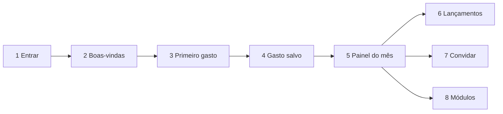

# Wireframes do fluxo principal

> **Status:** rascunho para revisão · **Data:** 2026-11-02 · Baixa fidelidade, mobile (≈ 360 px)
>
> Nomes e valores são fictícios. Cores, fontes e componentes seguem o
> [design system](design-system.md).

## Fluxo



Meta: de **1** até **4** em menos de 60 s, sem tutorial.

## 1. Entrar

```
┌──────────────────────────────────┐
│                                  │
│            Liberdade             │
│   As finanças da sua família,    │
│        simples e em paz.         │
│                                  │
│  ┌────────────────────────────┐  │
│  │  G   Entrar com Google     │  │
│  └────────────────────────────┘  │
│  ┌────────────────────────────┐  │
│  │  🔑  Entrar com passkey    │  │
│  └────────────────────────────┘  │
│                                  │
│   Sem senha. Nunca pedimos a     │
│   senha do seu banco.            │
│                                  │
│   Privacidade · Termos           │
└──────────────────────────────────┘
```

## 2. Boas-vindas (só no primeiro acesso)

```
┌──────────────────────────────────┐
│  Olá, Ana! 👋                    │
│                                  │
│  Nome da família                 │
│  ┌────────────────────────────┐  │
│  │ Família Souza              │  │
│  └────────────────────────────┘  │
│  Dá para mudar depois.           │
│                                  │
│  Ao começar, criamos:            │
│  ✓ Conta "Carteira"              │
│  ✓ Categorias do dia a dia       │
│                                  │
│  ┌────────────────────────────┐  │
│  │        Começar  →          │  │
│  └────────────────────────────┘  │
└──────────────────────────────────┘
```

## 3. Primeiro gasto

```
┌──────────────────────────────────┐
│  ←  Novo gasto                   │
│  [ Gasto ] Receita  Transferência│
│                                  │
│           R$ 0,00                │
│                                  │
│  Categoria                       │
│  (🛒 Mercado) (🍽 Alimentação)   │
│  (🚌 Transporte) (🏠 Moradia)    │
│  (💊 Saúde) (🎉 Lazer)  (+ Mais) │
│                                  │
│  Hoje · Carteira · Eu       ✎    │
│  Descrição (opcional)            │
│                                  │
│  ┌─────┬─────┬─────┐             │
│  │  1  │  2  │  3  │             │
│  │  4  │  5  │  6  │  ┌────────┐ │
│  │  7  │  8  │  9  │  │ Salvar │ │
│  │  ⌫  │  0  │ 00  │  └────────┘ │
│  └─────┴─────┴─────┘             │
└──────────────────────────────────┘
```

- O valor entra pela direita: 1, 2, 3, 4 → R$ 12,34.
- "Hoje · Carteira · Eu" abre uma folha para trocar data, conta e quem gastou.
- "Salvar" só habilita com valor > 0 e categoria escolhida.

## 4. Gasto salvo

```
┌──────────────────────────────────┐
│  Início                          │
│                                  │
│  Gastos em novembro              │
│  R$ 12,34                        │
│  Saldo total  R$ −12,34          │
│  Adicione suas contas para ver   │
│  o saldo real.                   │
│                                  │
│  Primeiros passos          ✕     │
│  ○ Adicionar suas contas         │
│  ○ Convidar a família            │
│  ○ Criar passkey neste aparelho  │
│                                  │
│ ┌──────────────────────────────┐ │
│ │ ✓ Gasto salvo     Desfazer   │ │
│ └──────────────────────────────┘ │
│  Início  Lançam.  (+)  Planejar  ⋯│
└──────────────────────────────────┘
```

- O aviso dura 5 s. "Desfazer" remove o gasto (ou tira da fila, se ainda não sincronizou).
- Enquanto as contas reais não forem cadastradas, a Carteira começa em R$ 0,00 e o saldo fica
  negativo. Por isso o destaque é o gasto do mês; o saldo aparece em segundo plano, com a dica.

## 5. Painel do mês

```
┌──────────────────────────────────┐
│  ‹  Novembro 2026  ›             │
│                                  │
│  Saldo total      R$ 4.765,44    │
│  ┌───────────┬───────────┐       │
│  │ Receitas  │ Gastos    │       │
│  │ +5.000,00 │ −1.234,56 │       │
│  └───────────┴───────────┘       │
│  Resultado do mês  +R$ 3.765,44  │
│                                  │
│  Gastos por categoria            │
│      ◔  Mercado      R$ 640,00   │
│         Moradia      R$ 400,00   │
│         Outras       R$ 194,56   │
│                                  │
│  Saldo no mês   ___/‾‾\___/‾     │
│  vs. outubro    ▇▅ ▃▆ ▂▂         │
│                                  │
│  Início  Lançam.  (+)  Planejar  ⋯│
└──────────────────────────────────┘
```

Tocar em uma categoria abre os lançamentos filtrados.

## 6. Lançamentos (com fila offline)

```
┌──────────────────────────────────┐
│  Lançamentos       🔍  Filtros   │
│  ⚠ Sem conexão. Lançar funciona; │
│    editar volta com o sinal.     │
│                                  │
│  Hoje                            │
│  🛒 Mercado          −R$ 87,90   │
│     Carteira · Ana   ☁ Aguardando│
│  🚌 Transporte       −R$ 4,50    │
│     Carteira · Léo   ⚠ Precisa de│
│                        atenção › │
│  Ontem                           │
│  💼 Salário        +R$ 5.000,00  │
│     Conta corrente · Ana         │
│  ↔ Transferência     R$ 500,00   │
│     Corrente → Poupança          │
│                                  │
│  Início  Lançam.  (+)  Planejar  ⋯│
└──────────────────────────────────┘
```

## 7. Convidar

```
┌──────────────────────────────────┐
│  ←  Convidar para a família      │
│                                  │
│  Papel                           │
│  (•) Adulto   lança e vê tudo    │
│  ( ) Jovem    só as contas dele  │
│  ( ) Leitor   só vê              │
│                                  │
│  Apelido (opcional)  [ Léo     ] │
│                                  │
│  ┌────────────────────────────┐  │
│  │      Gerar link            │  │
│  └────────────────────────────┘  │
│  O link vale 7 dias e só pode    │
│  ser usado uma vez.              │
│                                  │
│  [ Copiar ]  [ Compartilhar ]    │
└──────────────────────────────────┘
```

- Ao escolher "Jovem", aparece a caixa obrigatória "Sou responsável legal e autorizo o uso do app
  por este jovem". Sem ela, "Gerar link" fica desabilitado.
- O Jovem entra com a conta "Carteira de <apelido>" já criada, da qual é titular.

## 8. Módulos

```
┌──────────────────────────────────┐
│  ←  Módulos                      │
│  Ligue só o que fizer sentido.   │
│  Desligar esconde, não apaga.    │
│                                  │
│  Controle (sempre ligado)        │
│  Lançamentos, contas e painel    │
│  ─────────────────────────────── │
│  Planejamento               [●○] │
│  Orçamento, metas e reserva      │
│  ─────────────────────────────── │
│  Indicadores                [○●] │
│  Selic, CDI, IPCA e dólar        │
│  ─────────────────────────────── │
│  Conquistas                 [○●] │
│  Sequências e celebrações        │
│  ─────────────────────────────── │
│  Novo Projeto               [○●] │
│  Planeje uma renda extra         │
└──────────────────────────────────┘
```

## Telas das versões seguintes

### Orçamento (v0.2)

```
┌──────────────────────────────────┐
│  Orçamento · Novembro            │
│  🛒 Mercado                      │
│  ████████████████░░░░  80%       │
│  R$ 960 de R$ 1.200 · restam 240 │
│  🍽 Alimentação fora             │
│  █████████████████████ 105%      │
│  Passou R$ 30,00 do previsto     │
└──────────────────────────────────┘
```

### Meta (v0.2)

```
┌──────────────────────────────────┐
│  ✈ Viagem de férias              │
│  ██████░░░░░░░░░░░░░  25%        │
│  R$ 3.000 de R$ 12.000           │
│  Prazo: 9 meses                  │
│  Guardar R$ 1.000,00 por mês     │
│  [ + Aportar ]                   │
└──────────────────────────────────┘
```

### Indicadores (v0.3)

```
┌──────────────────────────────────┐
│  Indicadores                     │
│  Selic meta         x,xx% a.a.   │
│  CDI                x,xx% a.a.   │
│  IPCA 12 meses      x,xx%        │
│  Dólar PTAX         R$ x,xxxx    │
│  Fonte: Banco Central ·          │
│  atualizado em dd/mm/aaaa        │
│  ⓘ Conteúdo educativo. Não é     │
│    recomendação de investimento. │
└──────────────────────────────────┘
```

### Novo Projeto (v0.4)

```
┌──────────────────────────────────┐
│  🍫 Brigadeiros gourmet          │
│  Preço R$ 4,50 · custo R$ 1,80   │
│  Margem R$ 2,70 (60%)            │
│  Equilíbrio: 100 unidades/mês    │
│  Vendendo 300/mês:               │
│  Lucro R$ 540,00 · payback 2 m   │
│  ROI em 12 meses: 710%           │
│  [ Real vs. planejado › ]        │
└──────────────────────────────────┘
```
